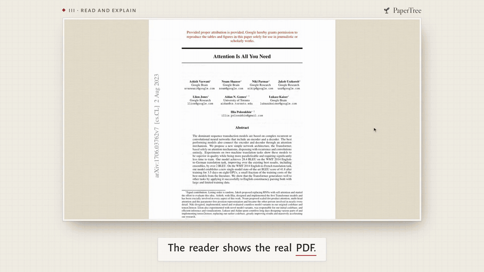
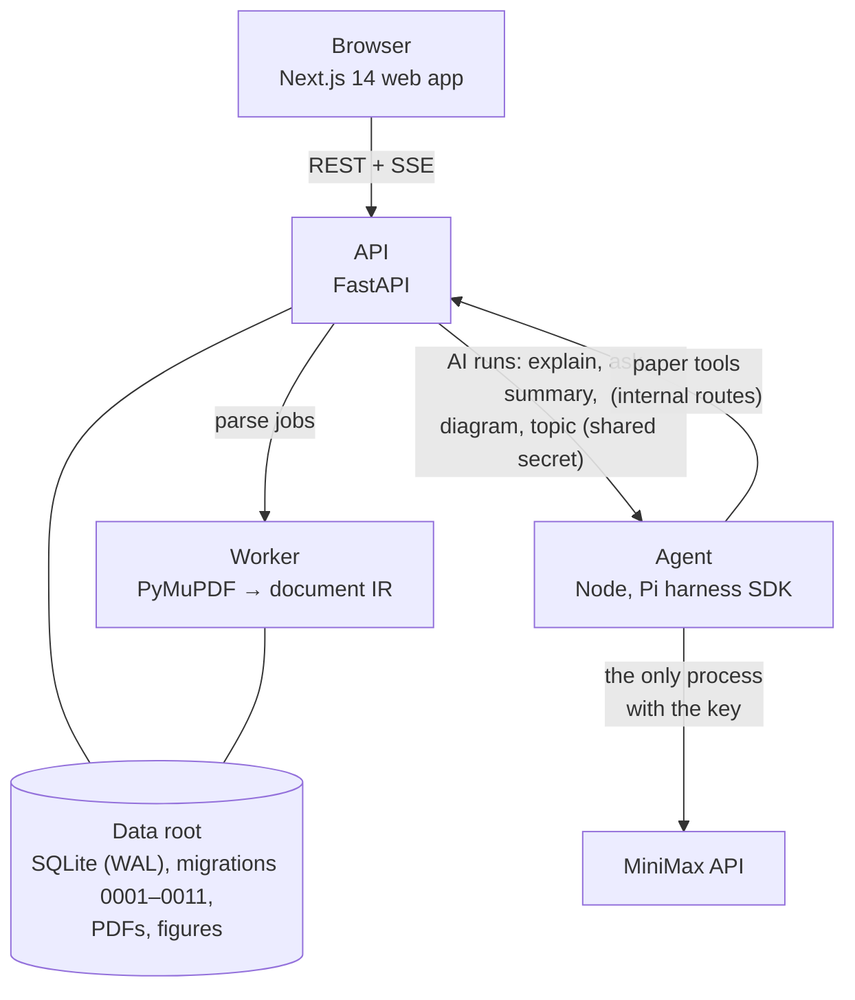

<div align="center">

# PaperTree

**Read research papers with an AI that shows its sources.**

<a href="docs/assets/readme/v0.2/papertree-v0.2.mp4"></a>

<sub>A real session on v0.2.0 with the live model, made with HyperFrames.
<a href="docs/assets/readme/v0.2/papertree-v0.2.mp4"><b>Watch the full product video (MP4)</b></a></sub>

<br/>

PaperTree is a reading room for research papers that runs on your machine. Your papers stand on a shelf.
The reader shows the real PDF. Select a passage and the AI explains it with numbered markers, each of which
flashes the passage it stands on, or draws a diagram whose every part is cited. Dive in from an answer to a
notebook page, and lay out what you found on a board.

[](https://github.com/Legend101Zz/PaperTree/releases/latest)
[](https://github.com/Legend101Zz/PaperTree/actions/workflows/ci.yml)
[](LICENSE)
[](https://github.com/Legend101Zz/PaperTree/commits/main)
[](https://github.com/Legend101Zz/PaperTree/stargazers)

[](https://nextjs.org)
[](https://www.typescriptlang.org)
[](https://nodejs.org)
[](https://www.python.org)
[](https://fastapi.tiangolo.com)
[](https://www.sqlite.org)
[](https://pnpm.io)
[](https://docs.astral.sh/uv/)
[](#model-policy)

[](#tests-and-quality-gates)
[](#tests-and-quality-gates)
[](#tests-and-quality-gates)
[](#how-v020-compares-with-the-last-release)

[Quick start](#quick-start) · [Features](#features) · [Screenshots](#screenshots) ·
[Release notes](#release-notes-v020) · [v0.3 plans](#v03-plans) · [Docs](#docs)

</div>

---

## Contents

- [Why PaperTree](#why-papertree)
- [Features](#features)
  - [Library](#library) · [Reader and explain](#reader-and-explain) · [Diagrams](#diagrams) ·
    [Notebook](#notebook) · [Board](#board) · [Phone and tablet](#phone-and-tablet) ·
    [Light and lamp-lit](#light-and-lamp-lit) ·
    [Accessibility and reduced motion](#accessibility-and-reduced-motion) · [Honesty rules](#honesty-rules)
- [Screenshots](#screenshots)
- [How it works](#how-it-works)
- [Quick start](#quick-start)
- [Configuration](#configuration)
- [Model policy](#model-policy)
- [Tests and quality gates](#tests-and-quality-gates)
- [Release notes (v0.2.0)](#release-notes-v020)
  - [What's new](#whats-new) ·
    [How v0.2.0 compares with the last release](#how-v020-compares-with-the-last-release)
- [Known limits (v0.2.0)](#known-limits-v020)
- [v0.3 plans](#v03-plans)
- [Troubleshooting](#troubleshooting)
- [Docs](#docs)
- [Contributing](#contributing)
- [Acknowledgements](#acknowledgements)
- [License](#license)
- [Author](#author)

## Why PaperTree

Most "chat with your PDF" tools turn the paper into text, lose the page, and give you answers you cannot
check. PaperTree keeps the paper as the paper:

- **You read the real pages.** Source mode is the PDF itself with selectable text. Guided mode reflows the
  paper's own words into one column, and Split shows both.
- **Every AI claim points back to the page.** An answer carries a numbered marker after each claim, and
  lists the passages it stands on. Click a marker and the reader scrolls to its passage and flashes it. A
  claim with no citation says so: "no citation · the AI's own reading".
- **Three voices, kept apart.** The paper's words, the AI's words and yours are styled differently on every
  screen: the reader, the notebook and the board.
- **Highlights stay where you put them.** They are stored as anchors and painted from stored coordinates,
  so they come back in the same place after a reload. A highlight that can't be placed goes to a tray with
  the reason; it is never painted in the wrong spot.
- **Nothing is made up to fill a gap.** The Map draws only real citation links, never "similar" papers. A
  missing value in the Table is a dash. A topic suggestion says where it came from.
- **Failures are shown, not hidden.** A PDF that can't be read says why. An AI run that fails or is
  stopped says so, and the part that did arrive is kept.
- **You can see what every AI call cost.** Each run records its model, tokens, estimated cost, latency
  and the exact code path. A daily spend cap is on by default.
- **It runs on your machine.** It uses one SQLite file and a data folder. The model key stays in one
  process.

## Features

What **v0.2.0** does, by area. The facts below come from each feature's README (linked under each
heading), where the rules, the data flow and the tests are. The CI suite of 88 Playwright specs runs the
app in Chromium against a scripted test model. Among them, the prototype-flow spec walks the design's
14-step flow, from the shelf to a thread on the board, at 1440 and 390 px in both colour schemes. During the
build the real model was called five times ([Metrics](#how-v020-compares-with-the-last-release)).

### Library

[`features/library`](apps/web/src/features/library/README.md),
[`features/book`](apps/web/src/features/book/README.md)

- **Add papers** from the header, or drop PDFs anywhere on the page. Each upload shows progress and Cancel.
- **The shelf:** the papers stand as cloth spines on a walnut plank, a row per topic under a brass label
  holder. Arrange by Topic, Year, Title or Recently opened. A spine shows its state. A red ribbon means you
  are reading it, a kraft wrap means it is still being read, and a torn red label means it could not be
  read (its card offers Retry). Twelve papers or fewer stand face-out as covers. Past 40, each row scrolls
  sideways and ends in a "+n more" bookend.
- **Search** ("/") dims what does not match and never reorders anything; the field says "2 of 24". The
  shelf is one tab stop: ←/→ walk along it, Home and End jump to its ends.
- **Reading now:** up to three papers you have a place in, each with its page ("p. 4 of 15") and
  Continue. The place is kept on the server, so it follows you to another browser.
- **Pull out and open the book:** Enter takes a spine out and turns it face-out; Enter again opens the
  spread. The left page is a bookplate ("From the library of …"). It asks for the name once and never
  makes one up from your email. When the parser found the paper's Figure 1, you can choose it as the plate
  instead. The right page has the topic and where it came from, then year · arXiv id · pages, the figures
  the parser found, the title and authors. Then come the abstract in the paper's words with its page tab,
  your place, the counts, Read and Summary. Esc puts the book back.
- **Topics:** a card per topic with its cloth, counts and a skyline of its spines. A new paper is offered
  a topic: one of yours that already holds a paper of the same arXiv category, else one short AI run,
  labelled "suggested by the AI (model)". An offer never shelves a paper; you accept it, refuse it or
  choose another topic.
- **Map:** a plan of the reading room, one island per topic. It draws only real citation links: a
  paper's references matched to another of your papers by arXiv id or by title, each labelled with how
  it matched. The same plan is also given as a text list.
- **Table:** a ruled catalogue (title, authors, year, topic and its source, pages, state, highlights, last
  opened). It sorts by any column and has chips, a filter and a choice of columns. "N need a look" opens it
  filtered to the papers that are queued, being read or failed.

### Reader and explain

[`features/reader`](apps/web/src/features/reader/README.md),
[`features/explain`](apps/web/src/features/explain/README.md),
[`features/highlights`](apps/web/src/features/highlights/README.md)

- **Three modes:** Source (the PDF, rendered with pdf.js, with selectable text), Guided (the paper's words
  in one column) and Split. Zoom, the mode and your place survive a reload. Contents has Outline (the real
  headings), Pages and Highlights.
- **The selection toolbar** sits in the page margin beside the selection, or docked at the top of the
  column, and never covers a selected line. It has Explain, Ask, Highlight in five washes, Send to board,
  Copy and Explain with a diagram.
- **Highlights:** a sentence, a table cell, a figure label or a passage across paragraphs. Change the
  colour, add a note, open one with a click, and delete it with Undo.
- **The explain exchange** (ask → answer → trace): your ask on a call slip, then the answer with a
  numbered marker after each claim, then the numbered passages it stands on. A coverage line sits above
  the passages: "Stands on 4 passages · 11 citations · 1 paragraph uncited". A marker's number is its
  passage's, the same in the answer, the trace and every later exchange of the thread. A marker and its
  trace row light each other, and either flashes the passage, with a margin tab "from marker 2 in the
  answer".
- **Ask** about the selection or about the whole paper, and ask follow-ups. The thread menu names each
  thread by its ask, and New thread starts another. A long thread opens with its earlier answers folded.
- **Streaming, Stop and Retry:** the working label ("Reading the paper…", "Writing…") and Stop stay in
  view. Stop says "Stopped. The part that arrived is kept." A refused ask keeps your words in the box. When
  the daily cap is reached, a card shows the figures and today's usage by kind.
- **The summary** is an exchange too: bullets with markers, each citation the check does not support
  marked "not verified", cached after the first run ("no new tokens used").

### Diagrams

[`features/diagram`](apps/web/src/features/diagram/README.md)

- **"Explain with a diagram"** on a selection draws an engraved plate of lettered parts (up to A–L) in the
  explain panel. Parts stream in and never move once placed.
- **Every part says where it stands:** **cited** (its quote is found word for word in the passage), **not
  verified** (its quote is near a passage, or found nowhere), or **inferred** (no quote; drawn dashed). The
  readout counts them: "5 parts · 5 cited · drawn by AI from p. 4".
- **The key is the plate's text alternative:** each row is a button with the part's words and its passage.
  Tapping a part, in the drawing or the key, flashes its passage.
- **Stop** keeps the parts that arrived, **Redraw** makes a new plate in the same thread with the same
  passage numbers, and **Send to board** makes a diagram card.

### Notebook

[`features/notebook`](apps/web/src/features/notebook/README.md)

- **Dive in** under an answer makes a bound page for it, one page per answer. The page holds the ask, the
  answer, the coverage line and one quote card per passage it cites, numbered as in the answer. A quote
  card's "Open source" goes back to its passage and flashes it.
- **Your own things:** typed notes, stickies, shapes (rectangle, ellipse, arrow) and five paper templates
  (blank, dot grid, lined, Cornell, derivation grid).
- **Ink:** pen, highlighter, stroke eraser and a lasso (keys P, H, E and L), three nibs and six colours.
  The lasso's menu has Ask about this, Make sticky, Send to board, Copy and Delete. The AI cannot read
  handwriting, so the actions that need words take only the typed notes and stickies inside the loop; an
  action with nothing to take stays disabled and says why.
- **Undo and redo** for notes, shapes and ink. Saving never fails silently: a change made somewhere else,
  a failed save or a deleted page each shows a notice, and nothing is dropped without a word.
- **Search** covers typed text, quotes and the answer (not handwriting). The side panel has the
  templates, the page's counts, and the page's card on the board. **Send page to board** puts the page on
  the board as one card. **Back to the paper** reopens the thread the page came from.

### Board

[`features/board`](apps/web/src/features/board/README.md)

- **The board**, formerly the canvas (`/paper/<id>/canvas` redirects to `/paper/<id>/board`). Index
  cards (passage, note, question, notebook page, diagram) and AI-slip cards (answers), sent from the
  reader, the notebook or the plate.
- **Brass pins:** evidence in, question in, claim out, answer out. Drag a thread from a brass pin; every
  pin that can take it lights, and a drop on the wrong pin is refused, in words.
- **Seven thread kinds** (supports, contradicts, derives from, answers, compares with, references, plain
  link), each with a colour **and** a second cue (a stitch or glyph, plus a paper tag). **Link as** opens at
  the thread's midpoint (keys 1–7; Esc keeps a plain link), and every new thread offers Undo.
- **By keyboard:** L on a focused card starts a thread, and Tab or the arrows walk the cards and pins it
  can reach.
- **Frames, a minimap, a toolbar** (Select, Add note, Add frame, Thread, Fit all, zoom 20–200 %) and an
  empty-board card. **Undo and redo** of moves, resizes, threads, edits and deletes (100 steps). An undo
  never overwrites a card changed in another tab without saying so; threads are checked on the client
  only, until they get a version ([#283](https://github.com/Legend101Zz/PaperTree/issues/283)).
- **500 cards:** on a big board only the cards in view are drawn, and below 45 % zoom each card is a
  glance (its kind and first words). A settled board makes no requests.
- A numbered marker on an answer card opens the reader at the cited passage and flashes it.

### Phone and tablet

- **Library** (up to 900 px wide): the books lie flat in stacks. A book opens its card as a bottom sheet,
  and "Open the book" opens the spread, which stacks at 390 px.
- **Reader** (below 768 px): the header is one row, with Contents, the mode, zoom and Board in a menu. The
  explain panel is a bottom sheet over a peek of the page. Each answer shows its first paragraph and "Read
  the whole answer". The markers and trace rows are 44 px targets. The usage line, Dive in and To board are
  pinned above the follow-up box.
- **Notebook:** on a tablet (768–1279 px) the tools become a rail, with pen input and palm rejection. On a
  phone the page reads as a stack with view-only ink. The pen works only when switched on, and the bar says
  that the lasso, shapes and templates are for a tablet or computer.
- **Board:** on a phone, Select and the zoom fold into More, and the minimap folds behind a Map button.
- In the library no page scrolls sideways at 320, 390 or 768 px, and on a phone or a touch screen the
  controls in its header, title row and hints are 44 px.

### Light and lamp-lit

[`features/settings`](apps/web/src/features/settings/README.md)

- **Aa** in the library header switches **System**, **Daylight** or **Lamp-lit**, kept per browser. A
  script inlined in the page applies the choice before the app's code runs, so a lamp-lit reader never sees
  a daylight flash on load.
- **The PDF page stays paper** in the lamp-lit scheme: a dimmed ivory with black type. The flash ring, the
  selection and the highlight washes on the page use colours chosen for it.
- Contrast is recomputed from the stylesheet by tests in both schemes. On the board, every thread colour,
  pin and glance edge must reach 3:1, and the words on cards, tags and the legend 4.5:1.

### Accessibility and reduced motion

- **Keyboard:** the shelf, the Topics grid and the phone's stacks are one tab stop each, walked with the
  arrows. The book is a modal dialog with focus kept inside it. The board has keyboard threading (L) and
  Link as by number, and the notebook has its tool keys. After a delete, focus moves to the next item
  rather than falling to the page.
- **Text alternatives:** the plate's key, the Map's text list, and named pins and buttons on the board.
- **axe** found 0 serious or critical issues after each of the prototype flow's 14 steps, at 1440 and 390
  px, daylight and lamp-lit ([Metrics](#how-v020-compares-with-the-last-release)).
- **Reduced motion:** every moment has a reduced path, measured by a spec against the design's reduced
  column. Pull out, open, put back, Read and Dive in are one 120 ms fade each. Explain, Back to the paper,
  the plate's parts and a new thread on the board have no motion, and the flash keeps only a 120 ms colour
  change between marker and trace row. The flash's scroll jumps straight to the passage.

### Honesty rules

These hold across the app.

- **The three voices are marked apart:** the paper's, the AI's and yours.
- **Every AI claim is cited or labelled.** A citation the grounding check does not support is marked "not
  verified". A claim with no citation is "the AI's own reading". A diagram part is cited, not verified, or
  inferred. The check is lexical, so it can be fooled
  ([Known limits](#known-limits-v020)).
- **No screen says "verified", "fact-checked" or "accurate".** A test scans the interface's strings for
  those words, and the prototype flow checks the screen after each step.
- **Every cost is an estimate, and says so.** A usage line under each answer gives tokens and the
  estimated cost, ending "(estimate)". Each run is recorded in `ai_runs` with its model, provider, tokens,
  cost, first-text time, latency, request id and code path. A daily budget caps your spend.
- **Nothing is invented to fill a gap:** no topic is set unless you accept or choose it, no "similar
  papers" are drawn on the Map, no bookplate name you did not give, and no figure count the parser did not
  find. A missing value is a dash.
- **The paper's figure is the only figure shown as the paper's.** An AI diagram is drawn on the AI's slip,
  under the AI tab.

## Screenshots

These show the v0.2 interface on `release/v0.2` at `a8eb3e5`; v0.2.0 adds S8's
[#320](https://github.com/Legend101Zz/PaperTree/pull/320) after it (the flow tests and two fixes to where a
sent card lands). They were taken from a production build (`next build` + `next start`) in Playwright's
Chromium at 1440 × 900 (1440 × 1000 for the notebook, 390 × 844 for the phone), on 2026-10-17, against a
copy of the demo data with nine more corpus papers uploaded, 13 in all (credited under
[Acknowledgements](#acknowledgements)).

**What is real in these shots.** Every paper was parsed by PaperTree. The explain thread on "Attention Is
All You Need" is real model output (MiniMax-M3.1-Flash-Preview, recorded on 2026-10-15 and stored in the
demo data). The plate is one live diagram run made for these screenshots (MiniMax-M3.1-Flash-Preview, 4,318
tokens, ≈ $0.0015, an estimate on M3 rates). The notebook page, the board's new cards and its three new
threads were made in the app from that thread (Dive in, Send to board, Send page to board, a brass pin, Link
as); the board's passage card, first answer, note and supports thread were already in the demo data. The
typed note, the sticky, the ink and the board's note are the demo account's own words. The topics, three reading places, the
bookplate's name and the board's layout were set through the API routes the app calls. No shot shows the
test model's answers.

<table>
  <tr>
    <td width="50%"><br/><sub><b>The shelf.</b> A row per topic; a ribbon marks a paper you are reading; Reading now above.</sub></td>
    <td width="50%"><br/><sub><b>The opened book.</b> Enter pulls a spine out, Enter again opens it; Esc puts it back.</sub></td>
  </tr>
  <tr>
    <td><br/><sub><b>Topics.</b> Each says where it came from: chosen by you, or suggested from the arXiv category and accepted.</sub></td>
    <td><br/><sub><b>The Map.</b> Only real citation links, each labelled with how it was matched.</sub></td>
  </tr>
  <tr>
    <td><br/><sub><b>The Table.</b> Sort, filter and choose columns; a missing value is a dash, never a guess.</sub></td>
    <td><br/><sub><b>Ask → answer → trace.</b> Marker 2 lights its passage on p. 2 and says so in the margin.</sub></td>
  </tr>
  <tr>
    <td><br/><sub><b>The plate.</b> Five parts, five cited; tapping part C flashes the paragraph it quotes.</sub></td>
    <td><br/><sub><b>The notebook.</b> Dive in makes a page from the answer: quote cards, then your notes and ink.</sub></td>
  </tr>
  <tr>
    <td><br/><sub><b>The board.</b> Threads of four kinds here, each a colour and a second cue (+, », dots, a line).</sub></td>
    <td><br/><sub><b>Lamp-lit.</b> The dark scheme keeps the PDF page paper-coloured.</sub></td>
  </tr>
</table>

<p align="center">
  
  &nbsp;
  
  &nbsp;
  
  <br/><sub><b>Phone (390 px).</b> The library, the explain sheet and the notebook.</sub>
</p>

Each slice's own shots, compared against the design's frames, are in
[`research/build/v0.2-ui/shots/`](research/build/v0.2-ui/shots/); the frames themselves are in
[`research/build/v0.2-ui/reference/`](research/build/v0.2-ui/reference/).

## How it works



- **Web** (`apps/web`): Next.js 14. The browser talks to the API and to nothing else. The interface
  lives in one folder per feature, `apps/web/src/features/<feature>/` (library, book, reader, explain,
  diagram, notebook, board, highlights, settings, design-system), each with a README; the shared components
  and the design tokens are in `packages/ui`. The reader renders pages with pdf.js; the board uses React
  Flow (`@xyflow/react`); notebook ink is `perfect-freehand` outlines on an SVG layer; motion is CSS and the
  Web Animations API, with no animation library
  ([ADR-004](research/architecture-decisions/ADR-004-v0.2-ui-stack.md)).
- **API** (`services/api`): FastAPI, the only public edge. Accounts, uploads, the paper store, highlights,
  reading state, topics, threads, summaries, notebooks, boards and the `ai_runs` ledger. Data lives in one
  SQLite file plus a few folders under the data root. The schema moves forward by numbered migrations
  (`infrastructure/migrations/`, 0001–0011; v0.2 adds 0006–0011), which the API and the worker apply when
  they start.
- **Worker** (`python -m papertree_api.worker`): parses uploaded PDFs with PyMuPDF into the paper's
  structure (sections, blocks, figures, tables, equations) while you wait. It shares the API's data root.
- **Agent** (`services/agent`): a small Node service that runs the AI through the Pi harness SDK against
  MiniMax. It binds `127.0.0.1`, is called only by the API, is the only process that ever holds the
  MiniMax key, and loads nothing from `~/.pi` or any `AGENTS.md`
  ([`services/agent/README.md`](services/agent/README.md)).

### Anchors, citations and the flash

- **Anchors.** A highlight, a citation, a notebook quote card, a board passage card, a diagram part and a
  book's plate each point at the paper through an Anchor (`@papertree/anchoring`, schema
  `contracts/anchor/anchor-v1.schema.json`). An Anchor holds the quoted text and the boxes it covers on the
  page, tied to the paper and its PDF's SHA-256. Highlights are painted from the stored boxes. For each
  parse the anchor is resolved to the paper's blocks, and the result is cached; a highlight that cannot be
  placed goes to the tray rather than to a guess. Anchors minted on the server cover whole blocks for now
  ([#123](https://github.com/Legend101Zz/PaperTree/issues/123)).
- **Citations.** The paper's text reaches the model marked as untrusted data, in passages labelled with
  handles such as `[b3]`, and the model cites by handle. Only handles issued in that run count: an
  invented one is dropped and logged. Each citation gets an Anchor. Each claim is checked against the
  passages it cites by a lexical check, and a citation carried by a claim that fails is shown as "not
  verified". A citation's locator (page, ¶, section) is derived from the parse when it is read, never
  stored.
- **The flash.** A marker, a trace row, a plate part, a quote card or an answer card on the board brings
  the reader to the passage's anchor. It scrolls (240 ms, and only if the passage is off screen), then
  flashes (in 180 ms, hold 900 ms, out 600 ms), then leaves a faint outline until your next key or press.
  A margin tab says where the flash came from ("from marker 2 in the answer", "from part C, …"). It works
  in Source mode; Guided does not have it yet
  ([#245](https://github.com/Legend101Zz/PaperTree/issues/245)).

### The flows

| Flow            | What happens                                                                                                                                                                                                                                                                                                                       | Stored in                                                     |
| --------------- | ---------------------------------------------------------------------------------------------------------------------------------------------------------------------------------------------------------------------------------------------------------------------------------------------------------------------------------- | ------------------------------------------------------------- |
| Library         | `GET /papers` carries each paper's reading state, the year and category from its arXiv id and stamp, counts, its topic and its plate. The reader writes your place with `PUT /papers/{id}/reading-state`.                                                                                                                          | `reading_state` (0006)                                        |
| Topics          | `GET /papers/{id}/topic` offers a topic: first your topic that already holds papers of the same arXiv category; when that finds nothing, one short `topic` run in the background (once per paper). An offer never shelves a paper; only `PUT /papers/{id}/topic` does.                                                             | `topics`, `paper_topics` (0009)                               |
| Map             | `GET /library/links` matches each paper's references to your other papers by arXiv id or by normalised title, and says which.                                                                                                                                                                                                      | nothing: computed on read                                     |
| The book        | `GET /papers/{id}/figures` and `/abstract`; `PUT`/`DELETE /papers/{id}/plate` chooses a figure as the cover; `PATCH /auth/me` sets the bookplate's name.                                                                                                                                                                           | `paper_plate` (0010), `users.display_name` (0006)             |
| Explain and ask | `POST /papers/{id}/threads` and `…/messages` stream the answer (SSE). Each citation's locator (page, ¶, section) and each answer's coverage are derived from the parse when read.                                                                                                                                                  | `ai_threads`, `ai_messages`, `ai_citations`, `ai_runs`        |
| Diagram         | `POST /papers/{id}/threads` with `kind: "diagram"`. The agent streams the plate as JSON lines (the title, each part, each link), each checked as it arrives; the API resolves each part's quote to an anchor (cited, not verified, or inferred when there is none) and streams `plate`, `part` and `link` events.                  | `ai_diagram_parts`, `ai_messages.diagram_json` (0011)         |
| Notebook        | Dive in is `POST /papers/{id}/notebook/pages` with the answer's message id: the server seeds the page with the ask, the answer and one quote card per cited passage (each an anchor). Items and ink strokes are saved under `/notebook/pages/{id}`; `GET /papers/{id}/notebook/search` searches typed text, quotes and the answer. | `notebook_pages`, `notebook_items`, `notebook_strokes` (0007) |
| Board           | `GET /papers/{id}/board`; cards and threads are created, moved and deleted one request per gesture. A thread names its pins (`from_port`, `to_port`), and the API refuses a pin pair its table does not allow (422).                                                                                                               | `canvas_nodes`, `canvas_edges` (rebuilt in 0008)              |

### AI run kinds

Every AI request is one run of one kind. The API starts it, the agent runs it, and its row in `ai_runs`
records the model, tokens, estimated cost and code path. The limits are the API's
(`services/api/python/papertree_api/agent_client.py`, `LIMITS`); the model for each kind is under
[Model policy](#model-policy).

| Kind      | Started by                                                                          | Deadline | Output tokens | Tool calls | Retries |
| --------- | ----------------------------------------------------------------------------------- | -------- | ------------- | ---------- | ------- |
| `explain` | Explain or Ask on a selection, and every follow-up in that thread                   | 45 s     | 4,096         | 8          | 1       |
| `ask`     | A question about the whole paper (no selection), and its follow-ups                 | 60 s     | 4,096         | 8          | 1       |
| `summary` | Summarize paper (cached afterwards)                                                 | 90 s     | 6,144         | 12         | 1       |
| `diagram` | Explain with a diagram, and Redraw                                                  | 90 s     | 2,048         | 4          | 1       |
| `topic`   | A paper the arXiv-category rule has no topic for, once per paper, in the background | 30 s     | 1,024         | none       | none    |

A follow-up runs as its thread's kind. A topic run that fails or answers badly is simply "no suggestion".

## Quick start

### Prerequisites

- Node.js 22.x (CI pins 22.23.0; see `.nvmrc`)
- pnpm, through Corepack: `corepack enable` (the version is pinned by `packageManager` in `package.json`)
- Python 3.12 and [uv](https://docs.astral.sh/uv/)
- A MiniMax API key for the AI features. Without one you can still upload, read, highlight and use the
  board; every AI request fails visibly, and the notebook has nothing to start from, since a page starts
  from an AI answer.
- A current Chrome (or another Chromium browser). v0.2.0's checks run in Playwright's Chromium. **In
  Safari (26.3.1), selecting text in Source mode does not open Explain or Ask**
  ([#327](https://github.com/Legend101Zz/PaperTree/issues/327)); use Chrome for now. Other browsers are
  untested (Safari's handling of the 3D book is not checked either).

### Run it

Run these from the repository root. You need four terminals, one per process; use the default ports
(8000, 8200, 3000) unless something else on your machine already uses them.

**1. Clone and install** (once):

```sh
git clone https://github.com/Legend101Zz/PaperTree.git
cd PaperTree
git checkout v0.2.0          # the latest release
corepack enable
uv sync --locked --all-packages
pnpm install --frozen-lockfile
```

**2. Configure** (once):

```sh
cp .env.example .env
echo "PAPERTREE_AGENT_SECRET=$(openssl rand -hex 32)" >> .env
cp apps/web/.env.example apps/web/.env.local
```

`.env` holds everything except the model key; the API, the worker and the agent each load it with the
`source` line below. The key is never put in this file.

**3. Start the four processes**, one per terminal:

```sh
# terminal 1: API (http://127.0.0.1:8000)
set -a; source .env; set +a
uv run python -m papertree_api
```

```sh
# terminal 2: worker (parses uploads; same data root as the API)
set -a; source .env; set +a
uv run python -m papertree_api.worker
```

```sh
# terminal 3: agent (http://127.0.0.1:8200). The key goes to this process only.
set -a; source .env; set +a
read -rs MINIMAX_KEY        # paste your MiniMax key, press Enter (nothing is echoed)
PAPERTREE_MINIMAX_API_KEY="$MINIMAX_KEY" pnpm --filter @papertree/agent start
```

```sh
# terminal 4: web (http://127.0.0.1:3000)
pnpm --filter papertree-web dev -H 127.0.0.1
```

(`-H 127.0.0.1` keeps the dev server off your network; without it Next.js listens on every interface.)

**4. Open the app** at **http://127.0.0.1:3000** (not `localhost`; see Troubleshooting). Register an
account and add a PDF:

- Press **Add papers** in the header, or drop PDFs anywhere on the library. A paper being read stands in a
  kraft wrap.
- Once it has been read, press Enter on it to take it out, Enter again to open the book, then **Read**.
  You can also click it to open its card.
- Select a sentence and use the toolbar in the margin: **Explain** (its numbered markers flash the
  passage), **Ask**, **Highlight**, **Send to board** or **Explain with a diagram**.
- **Dive in** under an answer opens its notebook page; **Board** in the reader's header opens the board.

Check that everything is up: `curl http://127.0.0.1:8000/healthz` and `curl http://127.0.0.1:8200/healthz`
(the agent's reply names the model per kind and says `key_present: true`).

Start the web app with `pnpm`, not `next dev` directly. Its `predev` step copies the pdf.js worker into
`apps/web/public/`; without it every PDF fails with "This PDF could not be opened".

Your data is in `~/.papertree` (SQLite, uploaded PDFs, extracted figures). Delete that folder to start
clean; set `PAPERTREE_DATA_ROOT` to keep it elsewhere. A data root from the earlier release works on
v0.2.0: the API applies the new migrations when it starts. Before the two table rebuilds it first copies the
database to `papertree.sqlite.pre-0008.bak` and `.pre-0011.bak`.

## Configuration

The variables below are every one the code reads, apart from test and research switches. The contract is
`research/build/reader-release/contracts.md` section 7. It, `.env.example` and `apps/web/.env.example`
do not list the four model variables for the `diagram` and `topic` kinds or
`NEXT_PUBLIC_PAPERTREE_DESIGN_SYSTEM` yet ([#323](https://github.com/Legend101Zz/PaperTree/issues/323)). Everything is optional
except the secret and the key.

<details>
<summary><b>All environment variables</b></summary>

| Variable                                                                          | Read by            | Default                   | Notes                                                                                                      |
| --------------------------------------------------------------------------------- | ------------------ | ------------------------- | ---------------------------------------------------------------------------------------------------------- |
| `PAPERTREE_DATA_ROOT`                                                             | api, worker        | `~/.papertree`            | SQLite plus `uploads/ assets/ staging/`; the API and the worker must share it                              |
| `PAPERTREE_HOST`, `PAPERTREE_PORT`                                                | api                | `127.0.0.1`, `8000`       |                                                                                                            |
| `PAPERTREE_SESSION_HOURS`                                                         | api                | `24`                      | login lifetime                                                                                             |
| `PAPERTREE_MAX_UPLOAD_MB`                                                         | api                | `100`                     | larger uploads are refused with 413                                                                        |
| `PAPERTREE_SIGNING_SECRET`                                                        | api                | random per boot           | asset URL signing; a restart invalidates open asset URLs unless you set it                                 |
| `PAPERTREE_AGENT_URL`                                                             | api                | `http://127.0.0.1:8200`   | where the API reaches the agent                                                                            |
| `PAPERTREE_AGENT_SECRET`                                                          | api, agent         | **required for AI**       | shared secret; the API answers 503 `not_configured` without it and the agent refuses to boot               |
| `PAPERTREE_DAILY_BUDGET_USD`                                                      | api                | `1.00`                    | per-user AI spend cap over a rolling 24 h, from `ai_runs.cost_usd_est`                                     |
| `PAPERTREE_CORS_ORIGINS`                                                          | api                | empty                     | extra browser origins beyond `http://localhost:*` and `http://127.0.0.1:*`                                 |
| `PAPERTREE_AGENT_PORT`                                                            | agent              | `8200`                    | binds `127.0.0.1` only                                                                                     |
| `PAPERTREE_API_INTERNAL_URL`                                                      | agent              | `http://127.0.0.1:8000`   | the API origin the agent fetches paper tools from                                                          |
| `PAPERTREE_MINIMAX_API_KEY`                                                       | **agent only**     | **required**              | read once, then removed from the agent's environment; never `MINIMAX_API_KEY`                              |
| `PAPERTREE_MODEL`                                                                 | agent              | per kind, see below       | one model for every kind: `MiniMax-M3` or `MiniMax-M3.1-Flash-Preview`                                     |
| `PAPERTREE_MODEL_EXPLAIN`, `_ASK`, `_SUMMARY`, `_DIAGRAM`, `_TOPIC`               | agent              | `PAPERTREE_MODEL`         | the model for one kind (`_DIAGRAM` and `_TOPIC` are new in v0.2)                                           |
| `PAPERTREE_MODEL_EFFORT` (+ `_EXPLAIN`, `_ASK`, `_SUMMARY`, `_DIAGRAM`, `_TOPIC`) | agent              | `low`                     | Flash only: `low`, `medium` or `high`                                                                      |
| `PAPERTREE_AGENT_LOG_LEVEL`                                                       | agent              | `info`                    | `debug` adds raw provider error text; keys and tokens are never logged                                     |
| `PAPERTREE_AGENT_FAUX`                                                            | agent              | unset                     | `1` = a scripted test model with canned answers (the e2e suite uses it); not for real use                  |
| `PI_OFFLINE`, `PI_TELEMETRY`, `PI_CODING_AGENT_DIR`                               | agent              | set by the agent          | defence in depth; do not set them                                                                          |
| `NEXT_PUBLIC_PAPERTREE_API_URL`                                                   | web                | `http://localhost:8000`   | the API origin as the browser reaches it; `apps/web/.env.example` sets `http://127.0.0.1:8000`             |
| `NEXT_PUBLIC_PAPERTREE_FIXTURES`                                                  | web                | `off`                     | `on` only in tests and demos                                                                               |
| `NEXT_PUBLIC_PAPERTREE_DESIGN_SYSTEM`                                             | web, at build time | off in a production build | v0.2: `on` serves the `/design-system` developer page from a production build; `next dev` always serves it |

</details>

To use a different port for the web app, set `PORT` (for example `PORT=3001 pnpm --filter papertree-web dev`).
If you move the API, change `PAPERTREE_PORT`, `PAPERTREE_API_INTERNAL_URL` and
`NEXT_PUBLIC_PAPERTREE_API_URL` together; if you move the agent, change `PAPERTREE_AGENT_PORT` and
`PAPERTREE_AGENT_URL`.

## Model policy

The agent decides which MiniMax model answers which kind of run (`services/agent/src/models.ts`,
`DEFAULT_MODELS`; [ADR-003](research/architecture-decisions/ADR-003-model-policy.md)). The defaults for explain, ask
and summary were chosen from an A/B test and a 3-judge quality panel ([`MODEL-AB.md`](docs/release/v0.1/MODEL-AB.md),
[`QUALITY.md`](docs/release/v0.1/QUALITY.md)):

| Kind                                                         | Model                                    | Why                                                                                                        |
| ------------------------------------------------------------ | ---------------------------------------- | ---------------------------------------------------------------------------------------------------------- |
| `explain`: a selection (and follow-ups in that thread)       | `MiniMax-M3.1-Flash-Preview`, effort low | First text p50 1.8 s in the A/B, against 9.3 s on M3                                                       |
| `ask`: a question about the whole paper (and its follow-ups) | `MiniMax-M3`                             | Flash's ask follow-ups drew 9 wrong-citation marks against 0 for M3 (3 follow-ups, 3 judges, summed)       |
| `summary`                                                    | `MiniMax-M3`                             | Flash summaries (effort medium) had 14 unsupported claims against 3 for M3 (3 summaries, 3 judges, summed) |
| `diagram` (v0.2)                                             | `MiniMax-M3.1-Flash-Preview`, effort low | A short, structured plate from one selection, like an explain. Not A/B-tested: two live runs so far        |
| `topic` (v0.2)                                               | `MiniMax-M3.1-Flash-Preview`, effort low | One short JSON answer per paper, no tools. Not A/B-tested: one live smoke (two calls)                      |

A follow-up stays on its thread's model. Follow-ups to an explanation therefore run on Flash; the quality
panel's follow-ups were all asks, so that case has not been measured. `PAPERTREE_MODEL=MiniMax-M3` puts every
kind on M3, and `PAPERTREE_MODEL_ASK=MiniMax-M3.1-Flash-Preview` puts ask back on Flash. MiniMax publishes no
price for Flash, so the cost recorded in `ai_runs` for Flash runs is an estimate on M3's rates, and the
agent's `/healthz` says so (`cost_basis`).

## Tests and quality gates

The commands CI runs (from the repository root; `.github/workflows/ci.yml` is authoritative). CI runs on
every pull request, whatever its base, and on every push to `main`:

| Gate               | Command                                                                                                                                                                                                                      |
| ------------------ | ---------------------------------------------------------------------------------------------------------------------------------------------------------------------------------------------------------------------------- |
| Codegen drift      | `pnpm run codegen`, then the working tree must be unchanged                                                                                                                                                                  |
| TypeScript         | `pnpm run typecheck`, `pnpm run lint` (oxlint for the packages and the agent, `next lint` for `apps/web`, a doc lint for `packages/ui`), `pnpm run test`                                                                     |
| Python             | `uv run pytest`, the peak-RSS test in its own process, `uv run ruff check packages services`, `uv run ruff format --check packages services`, `uv run mypy packages/*/python services/*/python`, `tools/check-docstrings.sh` |
| Prettier           | `pnpm exec prettier --check .` (it covers `apps/web` since v0.2)                                                                                                                                                             |
| Web build          | `pnpm --filter papertree-web build`                                                                                                                                                                                          |
| Fixture validation | `node .github/scripts/validate-fixtures.mjs packages/document-ir`                                                                                                                                                            |
| End to end         | `pnpm e2e` (Playwright; starts its own API, worker, web and a faux agent on free ports)                                                                                                                                      |

Locally, run the same gates uncached: `turbo` caches, so `pnpm test` can reprint a pass it did not run. The
exact list, with `--force`, is in [`CONTRIBUTING.md`](CONTRIBUTING.md#the-gate). `pnpm install` also
installs a pre-commit hook (lefthook) that runs Prettier and the linters on staged files.

- **End to end runs in GitHub Actions.** The E2E job runs the whole Playwright suite on every PR against a
  faux agent. It fails if any spec is skipped, if Journey B (it needs the YOLO PDF) did not pass, or if
  anything failed. You can run `pnpm e2e` yourself (it needs a Chromium:
  `pnpm exec playwright install chromium`); on the maintainer's machine the full suite is left to CI.
- **The live journey** (the real model) is a separate workflow, `live-journey.yml`, gated on the
  `run-live` label; it is not part of a normal run.
- **Web unit tests never touch the network** ([#310](https://github.com/Legend101Zz/PaperTree/issues/310),
  [#312](https://github.com/Legend101Zz/PaperTree/pull/312)). `apps/web/test/setup-no-network.ts` fails any
  test that makes an unmocked request and names the origin it tried. The agent's suite runs under an audit
  that fails it on any DNS lookup or non-loopback connection, with outbound network also denied by the OS
  where it can be (`sandbox-exec` on macOS, `unshare -rn` on Linux).
- **Corpus-gated tests.** Some tests need the benchmark PDFs, which are fetched rather than committed:
  `./research/benchmarks/fetch_corpus.sh` and `./research/benchmarks/fresh/fetch_fresh.sh`. Without them
  such a test skips and says so, naming the fetch script. CI fetches both sets, checks their checksums, and
  fails if any corpus- or fresh-gated test skipped. The web build needs them too: its `prebuild` step copies
  fixtures made from the corpus and fails without them.
- A few timing tests (`test_30k_*`, the migrations spec's 30k insert) are wall-clock bounds and can flake
  on a loaded machine: re-run them alone before diagnosing.

**The counts for v0.2.0** (each read from its own run's log):

- **TypeScript: 3,152 tests**: vitest 2,973 (web 1,571, document-ir 864, anchoring 336, ui 202) and 179
  agent tests. First counted on `release/v0.2` at `91857a4` (with S8) with
  `pnpm exec turbo run test --force`, 2026-10-17, load average 2.24 at the start. Re-run uncached for this
  README on `release/v0.2` at `065f709` (the commits since `91857a4` change only docs and two test names):
  the same 3,152, 0 of 9 turbo tasks cached, load average 2.74 at the start.
- **pytest: 2,562 passed**, 4 skipped, 1 expected failure, with the peak-RSS test passing in its own process.
  The local gate on `cbe70fa` (the head of [#320](https://github.com/Legend101Zz/PaperTree/pull/320), S8),
  2026-10-17, load average 19.32 at the start; the CI run on #320 counted the same.
- **e2e: 88 of 88** Playwright specs passed in 30.1 min, none skipped, in the CI run on #320
  ([run 39015930115](https://github.com/Legend101Zz/PaperTree/actions/runs/39015930115)), which tested
  `cbe70fa` merged into `release/v0.2`.

## Release notes (v0.2.0)

**v0.2.0** is the "Ex Libris" release: the whole interface rebuilt from one design, plus a notebook and AI
diagrams. It was built on the `release/v0.2` branch and tracked in
[#182](https://github.com/Legend101Zz/PaperTree/issues/182). The design has 32 frames: 16 are done and 16
are partial, and each partial frame has an issue in [v0.3 plans](#v03-plans). The build's plan, audit and
results are in [`research/build/v0.2-ui/`](research/build/v0.2-ui/), with a verdict per frame in
[`RESULT.md`](research/build/v0.2-ui/RESULT.md). The notes are also on the
[GitHub release](https://github.com/Legend101Zz/PaperTree/releases/tag/v0.2.0).

### What's new

Each area is described in full under [Features](#features).

- **Library:** the shelf of cloth spines, a row per topic; search that dims; Reading now with Continue; a
  book you pull out and open, with a bookplate; Topics with suggestions that say where they came from; a
  Map of only real citation links; the Table; a phone layout of flat books.
- **Reader:** a new header and reader desk; the selection toolbar in the page margin; the explain exchange
  (ask → answer → trace) with markers numbered by passage, each of which flashes its passage with a margin
  tab; folded answers; the summary as an exchange; highlight delete with Undo; the explain panel as a
  bottom sheet on a phone.
- **Diagrams (new):** an engraved plate whose parts stream in, each cited, not verified or inferred.
- **Notebook (new):** Dive in from an answer to a bound page with quote cards, notes, ink and a lasso, on a
  computer, a tablet or a phone.
- **Board** (formerly the canvas): new cards with brass pins, seven thread kinds told apart by colour and a
  second cue, Link as, keyboard threading, frames, a minimap, undo and redo, and 500 cards.
- **Lamp-lit**, a dark scheme that keeps the PDF page paper, and the System / Daylight / Lamp-lit switch.
- **Reduced motion:** every animation has a reduced path, measured against the design.
- **Under the hood:** feature folders with pure, tested models; lint rules for docs, imports and
  accessibility; docstrings on new Python modules; Prettier on `apps/web`; a pre-commit hook; migrations
  0006–0011; the agent's `diagram` and `topic` kinds. New runtime dependencies: `perfect-freehand` 1.2.3
  (MIT) and five Fontsource font packages (SIL OFL 1.1)
  ([ADR-004 §3](research/architecture-decisions/ADR-004-v0.2-ui-stack.md)).

### How v0.2.0 compares with the last release

| Metric               | v0.1.0                                                                        | v0.2.0                                                                                                                                                                          | Source                                                                                               |
| -------------------- | ----------------------------------------------------------------------------- | ------------------------------------------------------------------------------------------------------------------------------------------------------------------------------- | ---------------------------------------------------------------------------------------------------- |
| TypeScript tests     | 1,858                                                                         | **3,152**                                                                                                                                                                       | v0.1: `docs/METRICS.md`; v0.2: `turbo run test --force` on `91857a4`, re-run on `065f709`            |
| pytest               | 2,236 passed                                                                  | **2,562 passed**, 4 skipped, 1 expected failure                                                                                                                                 | v0.1: `docs/METRICS.md`; v0.2: CI run 39015930115 on #320                                            |
| e2e (Playwright)     | 60 of 60                                                                      | **88 of 88**, in 30.1 min                                                                                                                                                       | v0.1: `docs/METRICS.md`; v0.2: CI run 39015930115 on #320                                            |
| axe                  | 0 serious or critical in 12 combinations; canvas and explain panel not tested | **0 serious or critical** after each of the 14 steps of the prototype flow, at 1440 and 390 px, daylight and lamp-lit: library, book, reader, explain panel, notebook and board | v0.1: `docs/METRICS.md`; v0.2: S8's `e2e/v02/prototype-flow.spec.ts` (#320)                          |
| Design frames        | none                                                                          | 32: 16 done, 16 partial (each with its issue)                                                                                                                                   | `RESULT.md`, "Frames"                                                                                |
| 500 cards on a board | all 500 drawn; first view at the 0.2 zoom floor, unreadable; loaded in 553 ms | only the cards in view drawn; all 500 readable as glances at 20 %; first card 198–245 ms                                                                                        | v0.1: [`GAP-AUDIT.md`](research/build/v0.2-ui/GAP-AUDIT.md) on `79f637d`; v0.2: S8; different probes |
| Live AI spend        | —                                                                             | 5 live calls during the build, ≈ $0.0058 in all (estimates)                                                                                                                     | `RESULT.md`, "Live AI spend"                                                                         |

**Got worse:** the CI Python job went from 15 min 55 s to 18 min 44 s, and the E2E job from 19 min 33 s
with 60 specs to 31 min 14 s with 88. Selecting text in Safari's Source mode is a new known break
([#327](https://github.com/Legend101Zz/PaperTree/issues/327)). No live-journey run and no hands-on walk
on the live model were made for v0.2.0. The rest, with sources, machine loads, the numbers at scale and
what was not measured, is in [`docs/METRICS.md`](docs/METRICS.md#v02-against-v01).

Earlier releases: [v0.1.0](https://github.com/Legend101Zz/PaperTree/releases/tag/v0.1.0) · full history in [CHANGELOG.md](CHANGELOG.md) and [docs/METRICS.md](docs/METRICS.md).

## Known limits (v0.2.0)

- **Safari:** selecting paper text in Source mode does not open Explain or Ask in Safari 26.3.1; it works in
  Chrome ([#327](https://github.com/Legend101Zz/PaperTree/issues/327)). CI's e2e runs Chromium only, and
  Playwright's WebKit build does not reproduce it. Firefox is untested.
- **Design frames still partial** (S8's verdicts): Enter in the library search opens the card instead of
  pulling the book out ([#313](https://github.com/Legend101Zz/PaperTree/issues/313)); topic banners never
  show the paper's Figure 1 ([#314](https://github.com/Legend101Zz/PaperTree/issues/314)); small library
  differences ([#315](https://github.com/Legend101Zz/PaperTree/issues/315)); Back from the notebook has no
  reverse page turn ([#316](https://github.com/Legend101Zz/PaperTree/issues/316)); the notebook has no
  figure crop tool and draws ink under the cards ([#317](https://github.com/Legend101Zz/PaperTree/issues/317));
  explain says "Summarize paper", shows no first-text time and no live trace while streaming
  ([#318](https://github.com/Legend101Zz/PaperTree/issues/318)); a diagram part stands on one passage and
  there is no crafted-figure job ([#319](https://github.com/Legend101Zz/PaperTree/issues/319)); the shelf's
  first and last label holders are clipped by its ends ([#324](https://github.com/Legend101Zz/PaperTree/issues/324)).
- **Citations:** the flash does not work in Guided mode yet
  ([#245](https://github.com/Legend101Zz/PaperTree/issues/245)); a ¶ number can be one off after a
  paragraph that continues across columns ([#234](https://github.com/Legend101Zz/PaperTree/issues/234));
  the coverage count treats a paragraph as cited when its only handles match no citation
  ([#246](https://github.com/Legend101Zz/PaperTree/issues/246)); summary citations have no ¶ or section
  ([#257](https://github.com/Legend101Zz/PaperTree/issues/257)); board passage cards say "p. 2" without the
  ¶ ([#255](https://github.com/Legend101Zz/PaperTree/issues/255)); a plate's flash marks the whole
  paragraph, not the quoted words ([#123](https://github.com/Legend101Zz/PaperTree/issues/123)). The
  grounding check is still lexical ([#179](https://github.com/Legend101Zz/PaperTree/issues/179)).
- **Missing actions:** the daily cap cannot be changed in the app
  ([#256](https://github.com/Legend101Zz/PaperTree/issues/256)); no Dive in or Send to board from the
  summary ([#258](https://github.com/Legend101Zz/PaperTree/issues/258)); no Add to notebook for a plate
  ([#276](https://github.com/Legend101Zz/PaperTree/issues/276)); pinch does not zoom the notebook on a
  tablet ([#292](https://github.com/Legend101Zz/PaperTree/issues/292)).
- **Phone and theme:** the flash's margin tab on a phone is off-screen or over the passage
  ([#279](https://github.com/Legend101Zz/PaperTree/issues/279)); on a phone after Fit all, the board's
  in-card pins and buttons are under the 24 px target size
  ([#282](https://github.com/Legend101Zz/PaperTree/issues/282)); two theme transitions leave a label
  unreadable for about 100 ms ([#308](https://github.com/Legend101Zz/PaperTree/issues/308)).
- **Board and notebook defects:** a notebook page's card squeezes its title under the miniature
  ([#322](https://github.com/Legend101Zz/PaperTree/issues/322)); the board accepts any id as a diagram
  card's plate ([#277](https://github.com/Legend101Zz/PaperTree/issues/277)); a notebook item's undo after
  a failed create can leave the item on the server
  ([#284](https://github.com/Legend101Zz/PaperTree/issues/284)); Dive in's page id is global, not per
  owner ([#300](https://github.com/Legend101Zz/PaperTree/issues/300)).
- **Parser:** A3C's title parses as "Abstract" ([#298](https://github.com/Legend101Zz/PaperTree/issues/298));
  two older parser issues are still open
  ([#101](https://github.com/Legend101Zz/PaperTree/issues/101),
  [#103](https://github.com/Legend101Zz/PaperTree/issues/103)).
- **Setup:** `.env.example` and `apps/web/.env.example` do not list v0.2's variables yet
  ([#323](https://github.com/Legend101Zz/PaperTree/issues/323)); the table under
  [Configuration](#configuration) does.
- **Not in v0.2.0:** audio and paper replay ([#5](https://github.com/Legend101Zz/PaperTree/issues/5)), OCR
  or scanned PDFs, memory write-back, a hosted version and a Docker setup.

## v0.3 plans

v0.3 is tracked in [#329](https://github.com/Legend101Zz/PaperTree/issues/329), and every issue in it
carries the [`v0.3` label](https://github.com/Legend101Zz/PaperTree/issues?q=is%3Aopen+label%3Av0.3) (41
open as of this README). It finishes the Ex Libris design, makes PaperTree work in every major browser, and
tightens the reading truth. This section lists only what those issues hold; new work gets an issue before
it starts.

1. **Finish the Ex Libris design** (the 16 partial frames). Enter in the library search pulls the book
   out ([#313](https://github.com/Legend101Zz/PaperTree/issues/313)); topic banners show the paper's Figure 1
   ([#314](https://github.com/Legend101Zz/PaperTree/issues/314)); Dive in gets a reverse page turn on Back
   ([#316](https://github.com/Legend101Zz/PaperTree/issues/316)); the notebook gets a figure crop tool
   ([#317](https://github.com/Legend101Zz/PaperTree/issues/317)); explain gets the first-text time and a live
   trace ([#318](https://github.com/Legend101Zz/PaperTree/issues/318)); diagram parts can stand on several
   passages ([#319](https://github.com/Legend101Zz/PaperTree/issues/319)). Also
   [#315](https://github.com/Legend101Zz/PaperTree/issues/315),
   [#255](https://github.com/Legend101Zz/PaperTree/issues/255),
   [#322](https://github.com/Legend101Zz/PaperTree/issues/322) and
   [#324](https://github.com/Legend101Zz/PaperTree/issues/324).
2. **Every major browser.** Explain and Ask from a selection in Safari
   ([#327](https://github.com/Legend101Zz/PaperTree/issues/327)); the theme transitions that leave a label
   unreadable ([#308](https://github.com/Legend101Zz/PaperTree/issues/308)); dark-scheme axe checks that may
   run in daylight ([#269](https://github.com/Legend101Zz/PaperTree/issues/269)). Then WebKit and Firefox in
   CI's e2e and a manual real-Safari check on the release checklist (its issue is filed when it starts).
3. **Reading truth: citations, anchors, the parser.** The flash in Guided mode
   ([#245](https://github.com/Legend101Zz/PaperTree/issues/245)), ¶ locators
   ([#234](https://github.com/Legend101Zz/PaperTree/issues/234)), the coverage count
   ([#246](https://github.com/Legend101Zz/PaperTree/issues/246)), summary citation locators
   ([#257](https://github.com/Legend101Zz/PaperTree/issues/257)), the phone margin tab
   ([#279](https://github.com/Legend101Zz/PaperTree/issues/279)), sub-block anchors
   ([#123](https://github.com/Legend101Zz/PaperTree/issues/123)) and the reader's leftovers
   ([#176](https://github.com/Legend101Zz/PaperTree/issues/176)). Parser: a held-out set, pinned corpus URLs
   and text beside tables ([#180](https://github.com/Legend101Zz/PaperTree/issues/180)), plus
   [#101](https://github.com/Legend101Zz/PaperTree/issues/101),
   [#103](https://github.com/Legend101Zz/PaperTree/issues/103) and
   [#298](https://github.com/Legend101Zz/PaperTree/issues/298).
4. **Notebook and board depth.** Board threads get a version, like cards
   ([#283](https://github.com/Legend101Zz/PaperTree/issues/283)); Dive in and Send to board from the summary
   ([#258](https://github.com/Legend101Zz/PaperTree/issues/258)); a plate in the notebook
   ([#276](https://github.com/Legend101Zz/PaperTree/issues/276)); pinch zoom on a tablet
   ([#292](https://github.com/Legend101Zz/PaperTree/issues/292)). Also
   [#284](https://github.com/Legend101Zz/PaperTree/issues/284),
   [#300](https://github.com/Legend101Zz/PaperTree/issues/300),
   [#277](https://github.com/Legend101Zz/PaperTree/issues/277),
   [#282](https://github.com/Legend101Zz/PaperTree/issues/282),
   [#178](https://github.com/Legend101Zz/PaperTree/issues/178) and
   [#309](https://github.com/Legend101Zz/PaperTree/issues/309).
5. **AI.** The grounding check's limits, Flash re-tests, M3 latency and the Stop copy
   ([#179](https://github.com/Legend101Zz/PaperTree/issues/179)); changing the daily cap in the app
   ([#256](https://github.com/Legend101Zz/PaperTree/issues/256)).
6. **CI, tooling and docs.** Faux `ai_runs` rows, the Linux network-deny audit and the Python job's time
   ([#181](https://github.com/Legend101Zz/PaperTree/issues/181)); the env files and `contracts.md` list v0.2's
   variables ([#323](https://github.com/Legend101Zz/PaperTree/issues/323)). Also
   [#219](https://github.com/Legend101Zz/PaperTree/issues/219),
   [#268](https://github.com/Legend101Zz/PaperTree/issues/268) and
   [#129](https://github.com/Legend101Zz/PaperTree/issues/129).

**Beyond v0.3.** EPIC 4, Audiobook and Paper Replay
([#5](https://github.com/Legend101Zz/PaperTree/issues/5)): a narration generated from the paper's section
tree, in which tapping a paragraph jumps the audio there and every spoken segment knows which blocks it came
from. The tracker also lists three owner-only issues that builds leave alone
([#136](https://github.com/Legend101Zz/PaperTree/issues/136),
[#54](https://github.com/Legend101Zz/PaperTree/issues/54),
[#62](https://github.com/Legend101Zz/PaperTree/issues/62)).

## Troubleshooting

<details>
<summary><b>Common problems and fixes</b></summary>

- **The page is zoomed or looks wrong on `localhost`.** Chrome keeps a saved zoom level per host name.
  Browse `http://127.0.0.1:3000` instead.
- **"This PDF could not be opened".** The web app was started with `next dev` instead of
  `pnpm --filter papertree-web dev`, so the pdf.js worker was never copied. Restart it with pnpm.
- **Selecting text in Safari does nothing.** In Source mode, Safari 26.3.1 does not open Explain or Ask
  from a selection ([#327](https://github.com/Legend101Zz/PaperTree/issues/327)). Use Chrome.
- **Port already in use.** Something else owns 8000, 8200 or 3000 (3000 is a common one). Pick other ports
  as described under Configuration; the four processes only need to agree with each other.
- **A spine stays in its kraft wrap** (the paper is never read). The worker is not running, or it was
  started with a different `PAPERTREE_DATA_ROOT` than the API. Both load `.env`; do not override one of
  them.
- **Explain answers "AI explanations are not configured" (503).** `PAPERTREE_AGENT_SECRET` is missing in the
  API's environment. Re-run the `echo ... >> .env` line, then restart the API and the agent.
- **The agent exits at boot** with one `agent.boot.refused` line naming the problem: usually
  `PAPERTREE_AGENT_SECRET` or `PAPERTREE_MINIMAX_API_KEY` is unset. An ambient `MINIMAX_API_KEY` is not
  used: the agent deletes it at boot and reads only `PAPERTREE_MINIMAX_API_KEY`.
- **Where the key goes.** To the agent process only, inline on its start command. If you put it in `.env` it
  is also loaded into the API and the worker, which must not hold it.
- **Daily budget reached.** AI requests are refused once your estimated spend in the last 24 h passes
  `PAPERTREE_DAILY_BUDGET_USD`; the refusal says so. The cap is set in the environment, not in the app
  ([#256](https://github.com/Legend101Zz/PaperTree/issues/256)).
- **No topic is suggested.** The arXiv-category rule only offers a topic you already use for that
  category. Otherwise the suggestion is one AI run per paper, which needs the agent and the key, runs in the
  background and shows on a later look; any failure is just "No suggestion yet". You can always choose a
  topic yourself.
- **The scheme is not the one you want.** Aa in the library header switches System, Daylight and
  Lamp-lit; the choice is kept per browser.
- **`/design-system` answers 404** in a production build. Build with `NEXT_PUBLIC_PAPERTREE_DESIGN_SYSTEM=on`;
  `next dev` always serves it.
- **Reset everything.** Stop the four processes, delete the data root (`~/.papertree` by default).

</details>

## Docs

- [`research/architecture-decisions/ADR-002-reader-release.md`](research/architecture-decisions/ADR-002-reader-release.md):
  the architecture and why
- [`research/architecture-decisions/ADR-003-model-policy.md`](research/architecture-decisions/ADR-003-model-policy.md):
  the model policy
- [`research/architecture-decisions/ADR-004-v0.2-ui-stack.md`](research/architecture-decisions/ADR-004-v0.2-ui-stack.md):
  what the v0.2 interface is built with, and what was rejected
- [`research/build/reader-release/contracts.md`](research/build/reader-release/contracts.md): the normative
  wire, database and environment contracts
- [`contracts/README.md`](contracts/README.md): the generated JSON schemas
- [`services/agent/README.md`](services/agent/README.md): the agent service
- **The features**, one README each: [library](apps/web/src/features/library/README.md),
  [book](apps/web/src/features/book/README.md), [reader](apps/web/src/features/reader/README.md),
  [explain](apps/web/src/features/explain/README.md), [diagram](apps/web/src/features/diagram/README.md),
  [notebook](apps/web/src/features/notebook/README.md), [board](apps/web/src/features/board/README.md),
  [highlights](apps/web/src/features/highlights/README.md), [settings](apps/web/src/features/settings/README.md),
  [design system](apps/web/src/features/design-system/README.md)
- **The v0.2 build** ([`research/build/v0.2-ui/`](research/build/v0.2-ui/)):
  [`PLAN.md`](research/build/v0.2-ui/PLAN.md) (the slices and their issues),
  [`GAP-AUDIT.md`](research/build/v0.2-ui/GAP-AUDIT.md) (the design against the app it replaced),
  [`RESULT.md`](research/build/v0.2-ui/RESULT.md) (the gates, the slices, the live spend, a verdict per
  frame), [`STATE.md`](research/build/v0.2-ui/STATE.md), the research notes on the
  [canvas](research/build/v0.2-ui/RESEARCH-R1-canvas.md), [ink](research/build/v0.2-ui/RESEARCH-R2-ink.md)
  and [diagrams and motion](research/build/v0.2-ui/RESEARCH-R3-diagrams-motion.md), and the design's
  [frames](research/build/v0.2-ui/reference/)
- [`docs/METRICS.md`](docs/METRICS.md): release metrics, and what got better or worse
- [`CHANGELOG.md`](CHANGELOG.md): the changelog
- [`AGENTS.md`](AGENTS.md): working rules and hazards for contributors and coding agents
- [`CONTRIBUTING.md`](CONTRIBUTING.md): setup, dev ports, the gate, lint rules, code layout
- [`archive/README.md`](archive/README.md): the retired v1 code, kept for reference and not part of the
  build

## Contributing

Issues and pull requests are welcome. Before you open a PR:

1. Read [`AGENTS.md`](AGENTS.md) and [`CONTRIBUTING.md`](CONTRIBUTING.md): the repository's working rules,
   its known hazards, the code layout and the lint rules.
2. Work on a branch and open a PR against `main`. Describe what you changed and how you checked it.
3. Run the gates in [Tests and quality gates](#tests-and-quality-gates) that cover your change. CI runs all
   of them on every PR, the e2e suite included.
4. Never commit a key, a secret or a machine-specific absolute path.

The v0.3 tracker ([#329](https://github.com/Legend101Zz/PaperTree/issues/329)) is the best place to find
work.

## Acknowledgements

- Built on [pdf.js](https://mozilla.github.io/pdf.js/), [PyMuPDF](https://pymupdf.readthedocs.io/),
  [React Flow](https://reactflow.dev/) (`@xyflow/react`), [perfect-freehand](https://github.com/steveruizok/perfect-freehand),
  [Next.js](https://nextjs.org/), [FastAPI](https://fastapi.tiangolo.com/), the Pi harness SDK
  (`@earendil-works/pi-coding-agent`) and [MiniMax](https://www.minimax.io/) models.
- The v0.2 typefaces are Libre Caslon Display and Text, Alegreya Sans and Alegreya Sans SC, and Courier
  Prime (SIL Open Font License 1.1), self-hosted from the [Fontsource](https://fontsource.org/) packages.
- Product video made with [HyperFrames](https://github.com/heygen-com/hyperframes) (Apache-2.0); narration
  voice [Kokoro-82M](https://huggingface.co/hexgrad/Kokoro-82M) (Apache-2.0).
- The screenshots and the product video show these papers, used as examples; they belong to their authors:
  - Vaswani et al., [_Attention Is All You Need_](https://arxiv.org/abs/1706.03762) (2017).
  - Redmon et al., [_You Only Look Once: Unified, Real-Time Object Detection_](https://arxiv.org/abs/1506.02640) (2016).
  - He et al., [_Deep Residual Learning for Image Recognition_](https://arxiv.org/abs/1512.03385) (2016).
  - Ho et al., [_Denoising Diffusion Probabilistic Models_](https://arxiv.org/abs/2006.11239) (2020).
  - Devlin et al., [_BERT: Pre-training of Deep Bidirectional Transformers for Language Understanding_](https://arxiv.org/abs/1810.04805) (2019).
  - Brown et al., [_Language Models are Few-Shot Learners_](https://arxiv.org/abs/2005.14165) (2020).
  - Chen et al., [_Neural Ordinary Differential Equations_](https://arxiv.org/abs/1806.07366) (2018).
  - Wang et al., [_SuperGLUE: A Stickier Benchmark for General-Purpose Language Understanding Systems_](https://arxiv.org/abs/1905.00537) (2019).
  - Kingma and Ba, [_Adam: A Method for Stochastic Optimization_](https://arxiv.org/abs/1412.6980) (2015).
  - Dao et al., [_FlashAttention: Fast and Memory-Efficient Exact Attention with IO-Awareness_](https://arxiv.org/abs/2205.14135) (2022).
  - He et al., [_Mask R-CNN_](https://arxiv.org/abs/1703.06870) (2017).
  - Reimers and Gurevych, [_Sentence-BERT: Sentence Embeddings using Siamese BERT-Networks_](https://arxiv.org/abs/1908.10084) (2019).
  - Zhang et al., [_PDF-to-Tree: Parsing PDF Text Blocks into a Tree_](https://aclanthology.org/2024.findings-emnlp.628/) (2024).

## License

PaperTree is released under the [MIT License](LICENSE). Copyright © 2026 Mrigesh Thakur.

The MIT license covers this repository's own code. Its dependencies keep their own licenses. Note that
the PDF parser uses [PyMuPDF](https://pymupdf.readthedocs.io/), which is licensed under the AGPL-3.0
(or a commercial license from Artifex). If you distribute PaperTree or run it as a network service for
others, check PyMuPDF's terms. The benchmark papers are fetched from their sources, not redistributed, and
keep their own licenses.

## Author

**Mrigesh Thakur** · GitHub [@Legend101Zz](https://github.com/Legend101Zz)

If PaperTree is useful to you, a ⭐ on the repository helps others find it.
