<div align="center">

# PaperTree

**Read research papers with an AI that shows its sources.**

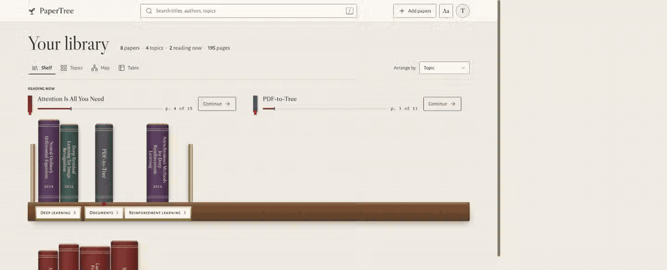

<sub>A real session on v0.3.0 with the live model, 31 seconds on a loop: the shelf, "Attention Is All You Need"
taken off it, its spread with the AI glance, Continue at p. 4, a passage selected, Explain streaming in, and
its Mermaid flowchart. <a href="docs/assets/readme/v0.2/papertree-v0.2.mp4">The v0.2 product video (MP4)</a>
is still here.</sub>

<br/>

PaperTree is a reading room for research papers that runs on your machine. Your papers stand on a shelf.
A click takes a paper off the shelf and opens it. The reader shows the real PDF. Select a passage, or click
a figure, and the AI answers like a tutor: a TL;DR, the idea in plain words, how it works (with a diagram
when one helps) and where it is in the paper, with a source line whose pages flash the passage. Dive in from
an answer to a notebook page, and send answers to a board that grows as a branching tree you can lay beside
the paper.

[](https://github.com/Legend101Zz/PaperTree/releases/latest)
[](https://github.com/Legend101Zz/PaperTree/actions/workflows/ci.yml)
[](LICENSE)
[](https://github.com/Legend101Zz/PaperTree/commits/main)
[](https://github.com/Legend101Zz/PaperTree/stargazers)

[](https://nextjs.org)
[](https://www.typescriptlang.org)
[](https://nodejs.org)
[](https://www.python.org)
[](https://fastapi.tiangolo.com)
[](https://www.sqlite.org)
[](https://pnpm.io)
[](https://docs.astral.sh/uv/)
[](#model-policy)

[](#tests-and-quality-gates)
[](#tests-and-quality-gates)
[](#tests-and-quality-gates)

[Quick start](#quick-start) · [Features](#features) · [Screenshots](#screenshots) ·
[Release notes](#release-notes-v030) · [Known limits](#known-limits-v030) · [Docs](#docs)

</div>

---

## Contents

- [Why PaperTree](#why-papertree)
- [Features](#features)
  - [Library](#library) · [Reader and explain](#reader-and-explain) · [Diagrams](#diagrams) ·
    [Images](#images) · [Notebook](#notebook) · [Board](#board) · [Phone and tablet](#phone-and-tablet) ·
    [Page colour and lamp-lit](#page-colour-and-lamp-lit) ·
    [Accessibility and reduced motion](#accessibility-and-reduced-motion) · [Honesty rules](#honesty-rules)
- [Screenshots](#screenshots)
- [How it works](#how-it-works)
- [Quick start](#quick-start)
- [Configuration](#configuration)
- [Model policy](#model-policy)
- [Tests and quality gates](#tests-and-quality-gates)
- [Release notes (v0.3.0)](#release-notes-v030)
  - [What's new](#whats-new) · [How v0.3.0 compares with v0.2.0](#how-v030-compares-with-v020)
- [Known limits (v0.3.0)](#known-limits-v030)
- [Next](#next)
- [Troubleshooting](#troubleshooting)
- [Docs](#docs)
- [Contributing](#contributing)
- [Acknowledgements](#acknowledgements)
- [License](#license)
- [Author](#author)

## Why PaperTree

Most "chat with your PDF" tools turn the paper into text, lose the page, and give you answers you cannot
check. PaperTree keeps the paper as the paper:

- **You read the real pages.** Source mode is the PDF itself with selectable text. Guided mode reflows the
  paper's own words into one column, and Split shows both.
- **Answers point back to the page.** Each answer ends with a source line ("From the paper: p. 7 · p. 2").
  Click a page and the reader scrolls to its passage and flashes it. An answer that drew on nothing in the
  paper says "General knowledge". PaperTree does not score claims: since v0.3 no screen says "verified" or
  "not verified", so read the passage.
- **Three voices, kept apart.** The paper's words, the AI's words and yours are styled differently on every
  screen: the reader, the notebook and the board.
- **Highlights stay where you put them.** They are stored as anchors and painted from stored coordinates,
  so they come back in the same place after a reload. A highlight that can't be placed goes to a tray with
  the reason; it is never painted in the wrong spot.
- **Nothing is made up to fill a gap.** The Map draws only real citation links, never "similar" papers. A
  missing value in the Table is a dash. A topic suggestion says where it came from.
- **Failures are shown, not hidden.** A PDF that can't be read says why. An AI run that fails or is
  stopped says so, and the part that did arrive is kept.
- **You can see what every AI call cost.** Each run records its model, tokens, estimated cost, latency
  and the exact code path. A daily spend cap is on by default.
- **It runs on your machine.** It uses one SQLite file and a data folder. The model key stays in one
  process.

## Features

What **v0.3.0** does, by area. The facts below come from each feature's README (linked under each
heading), where the rules, the data flow and the tests are. The e2e suite lists 103 Playwright specs; CI
runs them in Chromium against a scripted test model (the v0.3 metrics pass listed them and did not run them).
Every live-model figure in this README comes from MiniMax-M3.1-Flash runs made for the v0.3 build
([Metrics](#how-v030-compares-with-v020)).

### Library

[`features/library`](apps/web/src/features/library/README.md),
[`features/book`](apps/web/src/features/book/README.md)

- **Add papers** from the header, or drop PDFs anywhere on the page. Each upload shows progress and Cancel.
- **The shelf:** the papers stand as cloth spines on walnut planks, at every library size, a row per topic
  under a brass label holder. A spine's width follows its paper's page count. Arrange by Topic, Year, Title
  or Recently opened. A red ribbon means you are reading it, a kraft wrap means it is still being read, and
  a torn red label means it could not be read. Past 40 papers, each row scrolls sideways and ends in a "+n
  more" bookend.
- **Search** ("/") dims what does not match and never reorders anything; the field says "2 of 24". The
  shelf is one tab stop: ←/→ walk along it, Home and End jump to its ends.
- **Reading now:** up to three papers you have a place in, each with its page ("p. 4 of 15") and
  Continue. The place is kept on the server, so it follows you to another browser.
- **Take a book off the shelf:** a click (or Enter, or Space) on any spine, on any plank, takes that book
  out and opens it in one motion of about 880 ms: it slides out, turns to face you, grows into a cover, and
  the cover swings open. A click or any key skips to the end, Esc puts the book back, and reduced motion is
  a cross-fade. There is no card in between, so the book that opens is the one you clicked.
- **The spread:** the left page is a bookplate ("From the library of …"). It asks for the name once and
  never makes one up from your email. When the parser found the paper's Figure 1, you can choose it as the
  plate instead. The right page has the topic and where it came from, then year · arXiv id · pages, the
  figures the parser found, the title and authors. Then come the abstract in the paper's words, with its
  page tab, and **Paper at a glance**: a short AI sheet (problem, idea, how it works, results, limits, what
  to read first, words to know) made in the background when the paper is added and cached. Each block that
  names a page links to it. **Read** says "Continue at p. 4" once you have started. The **⋯** menu has
  Rename (the name is kept beside the paper and wins over the parsed title), Topic, and Delete, which closes
  the book and offers Undo for 10 s. Esc puts the book back.
- **Topics:** a card per topic with its cloth, counts and a skyline of its spines. A new paper is offered
  a topic: one of yours that already holds a paper of the same arXiv category, else one short AI run,
  labelled "suggested by the AI (model)". An offer never shelves a paper; you accept it, refuse it or
  choose another topic.
- **Map:** a plan of the reading room, one island per topic. It draws only real citation links: a
  paper's references matched to another of your papers by arXiv id or by title, each labelled with how
  it matched. The same plan is also given as a text list.
- **Table:** a ruled catalogue (title, authors, year, topic and its source, pages, state, highlights, last
  opened). It sorts by any column and has chips, a filter and a choice of columns. "N need a look" opens it
  filtered to the papers that are queued, being read or failed.

### Reader and explain

[`features/reader`](apps/web/src/features/reader/README.md),
[`features/explain`](apps/web/src/features/explain/README.md),
[`features/highlights`](apps/web/src/features/highlights/README.md)

- **Three modes:** Source (the PDF, rendered with pdf.js, with selectable text), Guided (the paper's words
  in one column) and Split. Zoom, the mode and your place survive a reload. Contents has Outline (the real
  headings), Pages and Highlights.
- **The selection menu** sits in the page margin beside the selection, or docks over the column when there
  is no margin, and never covers a selected line. It has Explain, Ask…, Send to board (to Board beside, or
  "just send"), Note and five highlight colours. A selection is painted as one band per line, so it reads
  as one wash across italics and inline maths. Enter on a fresh selection is Explain.
- **Highlights:** a sentence, a table cell, a figure label or a passage across paragraphs. Change the
  colour, add a note, open one with a click, and delete it with Undo.
- **The tutor answer.** The ask goes on a call slip; the AI's answer comes in sections: **TL;DR**, **In
  plain words**, **How it works** (maths typeset with KaTeX, and a diagram when one helps; see
  [Diagrams](#diagrams)) and **In the paper**. An answer can end with an optional "Check yourself" blank,
  which is marked in the browser. A **level switch** (New to this, Familiar, Expert) writes the answer again at another level: a level is
  asked once, and switching back shows the one already fetched. "Go deeper" chips under the last answer ask
  for a simpler version or one of a few fixed follow-ups.
- **Sources are quiet.** There are no chips between the words. Each answer ends with one line, "From the
  paper: p. 7 · p. 2", and each page is a button: hover or focus peeks the passage's first words, and a click
  scrolls the reader to it and flashes it. An answer that cites nothing says "General knowledge" there.
- **Ask** about the selection or about the whole paper, and ask follow-ups. The thread menu names each
  thread by its ask, and New thread starts another. A long thread opens with its earlier answers folded.
- **Streaming, Stop and Retry:** the working label ("Reading the paper…", "Writing…") and Stop stay in
  view. Stop says "Stopped. The part that arrived is kept." A refused ask keeps your words in the box. When
  the daily cap is reached, a card shows the figures and today's usage by kind. If the model stops
  responding, the answer says so and offers a retry.
- **The summary** is an exchange too: bullets, each with its source line, cached after the first run. It
  no longer shows how many passages it stands on.
- **Every run kind runs on MiniMax-M3.1-Flash** (explain and the spread's glance at effort low; ask, summary
  and image at effort medium). See [Model policy](#model-policy).

### Diagrams

[`features/diagram`](apps/web/src/features/diagram/README.md)

- **A diagram inside "How it works", when one helps.** The model writes it as a ` ```mermaid ` fence and
  picks the kind that fits the idea: a flowchart, sequence diagram, state diagram, mindmap, timeline,
  quadrant chart, xy chart or class diagram.
- **Checked before you see it.** The agent runs Mermaid's own parser on the fence before the answer is
  stored. It repairs what it can (statements split onto separate lines, shape characters quoted, one mindmap
  root), asks the model once to repair the rest, and otherwise drops the fence. A fence with HTML, a
  `click` or `href`, a directive, an unlisted kind or an oversized drawing is dropped. What you see live is
  what a reload shows.
- **Drawn in the browser, lazily.** Mermaid 12.2.0 is loaded only once a fence has closed; until then a
  quiet "drawing…" placeholder stands in its place, never raw code. It runs with Mermaid's strict security
  level and is themed from the app's own tokens, so Light, Sepia and Dark pages and the Daylight and
  Lamp-lit rooms each get their own colours, and it is redrawn when the theme changes. A fence that does not
  parse draws nothing.
- **Wide diagrams scroll.** A figure scales to its room but never below 70 % of its drawn size; a wider one
  scrolls sideways inside its box, and the box is a keyboard-reachable region. "Larger" shows it at its
  natural width. On a board card the figure is a whole-diagram preview, and "larger" opens it in a dialog.
  Its text alternative is "Diagram, flowchart: first labels".
- **Stress test.** Four rounds of live answers (96, 96, 96 and 64 from MiniMax-M3.1-Flash, over the eight
  corpus papers, with asks aimed at every kind) found 4 diagrams in 91 that did not render before the checks above, and 0
  in the 237 the reader was left looking at in rounds 2 to 4, in light and dark.
- **Diagrams from v0.2 still open.** A stored v0.2 diagram thread (the engraved plate of lettered parts)
  still renders in the panel and can be redrawn or sent to the board. "Explain with a diagram" is no longer
  a selection action, and the plate's "cited / not verified / inferred" labels are gone: a part that has a
  passage behind it says "From the paper: p. 4".

### Images

[`features/reader`](apps/web/src/features/reader/README.md#selecting-a-picture-v03-348)

- **One click selects a figure.** A figure, table, algorithm or display equation is outlined and labelled
  when you hover it, and a click selects the whole of it with its caption. Tab walks the figures in reading
  order and Enter selects one.
- **Or drag an area.** "Select area" in the reader's bar, or Alt and drag, draws a rectangle with eight
  handles; the arrow keys move it. Shift pairs a picture with words you selected.
- **The action bar:** Explain, Ask…, Board, Note and the highlight colours. Explain and Ask start an `image`
  run: the model is shown a tight, high-resolution crop of what you selected, and the crop stays on top of
  the thread. Send to board makes an image card. Note and a colour make a highlight over the region.
- Beside the board, the frame's chip can be dragged in, and the card lands where you drop it. An answer
  cannot yet point at a part of the picture ([#359](https://github.com/Legend101Zz/PaperTree/issues/359)).

### Notebook

[`features/notebook`](apps/web/src/features/notebook/README.md)

- **Dive in** under an answer makes a bound page for it, one page per answer. The page holds the ask, the
  answer and one quote card per passage it cites. A quote card's "Open source" goes back to its passage and
  flashes it.
- **Your own things:** typed notes, stickies, shapes (rectangle, ellipse, arrow) and five paper templates
  (blank, dot grid, lined, Cornell, derivation grid).
- **Ink:** pen, highlighter, stroke eraser and a lasso (keys P, H, E and L), three nibs and six colours.
  The lasso's menu has Ask about this, Make sticky, Send to board, Copy and Delete. The AI cannot read
  handwriting, so the actions that need words take only the typed notes and stickies inside the loop; an
  action with nothing to take stays disabled and says why.
- **Undo and redo** for notes, shapes and ink. Saving never fails silently: a change made somewhere else,
  a failed save or a deleted page each shows a notice, and nothing is dropped without a word.
- **Search** covers typed text, quotes and the answer (not handwriting). The side panel has the
  templates, the page's counts, and the page's card on the board. **Send page to board** puts the page on
  the board as one card. **Back to the paper** reopens the thread the page came from.

### Board

[`features/board`](apps/web/src/features/board/README.md),
[`features/split`](apps/web/src/features/split/README.md)

- **A branching tree.** Send a passage or an answer to the board and it becomes a card; ask on a card and
  the answer grows from it. **Down is a follow-up** (it continues the conversation), **right is a branch**
  (a different question from the same card). Select words in an answer and branch from them: the words stay
  underlined with a count. A card's "Uses" line says what the ask reads (this path, the paper, the level,
  whether it may draw a diagram), and an ask sends its path and anything you selected, never a sibling
  branch.
- **Moving around a tree.** Focus a path and the rest dims, with a **path breadcrumb**. **Fold** collapses
  what is under a card to a pill. **Tidy** lays the trees out; a drag moves a card with its whole branch,
  and a tree that grows a branch pushes its neighbour clear instead of sliding under it. **Keep as note**
  makes a note from words with no AI call.
- **Outline** shows the same tree as a study document, and exports it as **Markdown**.
- **Board beside** (key B, or from the selection menu) puts the paper on the left and the board on the
  right, with a draggable divider, a strip to fold either side, and a flash on the paper when you click a
  card's "p. n" while the board stays put. Drag a selection across the divider and it lands as a card at the
  drop point. Explain and the board share the right side, so opening one closes the other. Under 768 px the
  board opens full width instead.
- **The older cards still work.** Index cards (passage, note, question, notebook page, diagram) and AI-slip
  cards (answers); brass pins; seven thread kinds, each with a colour **and** a second cue, with Link as
  (keys 1–7) and threading by keyboard (L); frames, a minimap, a toolbar and an empty-board card; undo and
  redo (100 steps); and 500 cards, drawn as glances below 45 % zoom. A v0.2 card with no parent reads as a
  loose card and Tidy leaves it alone. The board was the canvas before v0.2
  (`/paper/<id>/canvas` redirects to `/paper/<id>/board`).

### Phone and tablet

- **Library** (up to 900 px wide): the books lie flat in stacks. A book opens its spread, which stacks at
  390 px.
- **Reader** (below 768 px): the header is one row, with Contents, the mode, zoom and Board in a menu. The
  explain panel is a bottom sheet over a peek of the page. Each answer shows its first paragraph and "Read
  the whole answer". The page buttons of a source line are 44 px targets. The usage line, Dive in and To
  board are pinned above the follow-up box.
- **Notebook:** on a tablet (768–1279 px) the tools become a rail, with pen input and palm rejection. On a
  phone the page reads as a stack with view-only ink. The pen works only when switched on, and the bar says
  that the lasso, shapes and templates are for a tablet or computer.
- **Board:** on a phone, Select and the zoom fold into More, and the minimap folds behind a Map button.
  The branching tree and Board beside were not designed for a phone or a tablet
  ([#347](https://github.com/Legend101Zz/PaperTree/issues/347) lists it as still to design).
- In the library no page scrolls sideways at 320, 390 or 768 px, and on a phone or a touch screen the
  controls in its header, title row and hints are 44 px.

### Page colour and lamp-lit

[`features/settings`](apps/web/src/features/settings/README.md)

- **Aa** in the library header switches the room: **System**, **Daylight** or **Lamp-lit**, kept per
  browser. A script inlined in the page applies the choice before the app's code runs, so a lamp-lit reader
  never sees a daylight flash on load.
- **The paper's page has its own colour:** in the reader's Aa menu, Page is **Auto, Light, Sepia or Dark**.
  Auto follows the room. Figures sit on a light mat that never covers a caption or a label, and the
  selection, the flash and the highlight washes are re-tuned for each page colour.
- Contrast is recomputed from the stylesheet by tests in both schemes. On the board, every thread colour,
  pin and glance edge must reach 3:1, and the words on cards, tags and the legend 4.5:1.

### Accessibility and reduced motion

- **Keyboard:** the shelf, the Topics grid and the phone's stacks are one tab stop each, walked with the
  arrows. The book is a modal dialog with focus kept inside it. The board has keyboard threading (L) and
  Link as by number, and the notebook has its tool keys. A diagram too wide for its box is a region you can
  scroll with the keys. After a delete, focus moves to the next item rather than falling to the page.
- **Text alternatives:** a diagram's name ("Diagram, flowchart: …"), the Map's text list, and named pins
  and buttons on the board.
- **axe** found 0 serious or critical issues after each of v0.2's prototype flow's 14 steps, at 1440 and
  390 px, daylight and lamp-lit. The v0.3 metrics pass did not re-run it
  ([Metrics](#how-v030-compares-with-v020)).
- **Reduced motion:** every moment has a reduced path. The book's opening is a cross-fade, the other
  moves are one 120 ms fade or none, and the diagram has no motion at all.

### Honesty rules

These hold across the app.

- **The three voices are marked apart:** the paper's, the AI's and yours.
- **Sources are shown, not scored.** An answer's source line names the pages it drew on, and "General
  knowledge" says it drew on none. v0.3 removed the lexical grounding check and with it every "verified"
  and "not verified" mark, so nothing on screen says a claim was checked. Read the passage.
- **No screen says "verified", "fact-checked" or "accurate".** A test scans the interface's strings for
  those words.
- **Every cost is an estimate, and says so.** A usage line under each answer gives tokens and the
  estimated cost, ending "(estimate)". Each run is recorded in `ai_runs` with its model, provider, tokens,
  cost, first-text time, latency, request id and code path. A daily budget caps your spend.
- **Nothing is invented to fill a gap:** no topic is set unless you accept or choose it, no "similar
  papers" are drawn on the Map, no bookplate name you did not give, and no figure count the parser did not
  find. A missing value is a dash. A diagram that cannot be drawn is left out, not shown as code.
- **The paper's figure is the only figure shown as the paper's.** A diagram is drawn on the AI's slip,
  under the AI tab.

## Screenshots

These show the v0.3 interface: the release build (`next build` + `next start`) of `release/v0.3` plus
[#373](https://github.com/Legend101Zz/PaperTree/pull/373), the pull request that holds these shots and six
small fixes to the shelf and the board. They were taken on 2026-11-21 in Chromium at 1440 × 900 (390 × 844
at 2× for the phone), on a fresh data root with the eight corpus papers uploaded (credited under
[Acknowledgements](#acknowledgements)).

**What is real in these shots.** Every paper was parsed by PaperTree. Every answer is live
MiniMax-M3.1-Flash output, made for these shots; none is the test model's. The Mermaid diagram is the one
the same answer carried. Three of the board's answers were sent from the reader, and the follow-up and the
branch on the middle one were asked on the board. Four things were set by hand, through the app's own API
routes and screens: the topics, two titles (A3C's parsed title was "Abstract", and BERT's was cut short, so
both were renamed), and the bookplate's name, "The Reading Room". The demo loop above is a 31-second
recording of the same app.

<table>
  <tr>
    <td width="50%">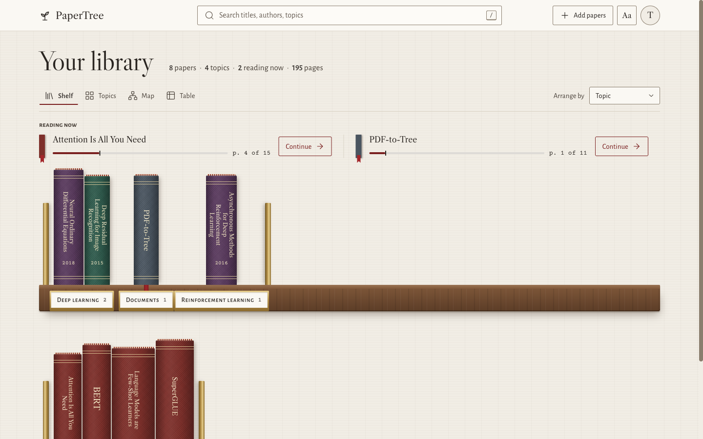<br/><sub><b>The shelf.</b> Reading now above; a spine's width follows its page count; a row per topic.</sub></td>
    <td width="50%">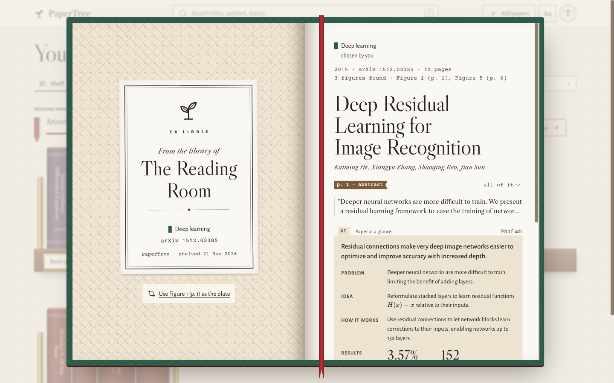<br/><sub><b>Off the shelf.</b> One click opens the spread: the abstract in the paper's words, then the AI's glance.</sub></td>
  </tr>
  <tr>
    <td>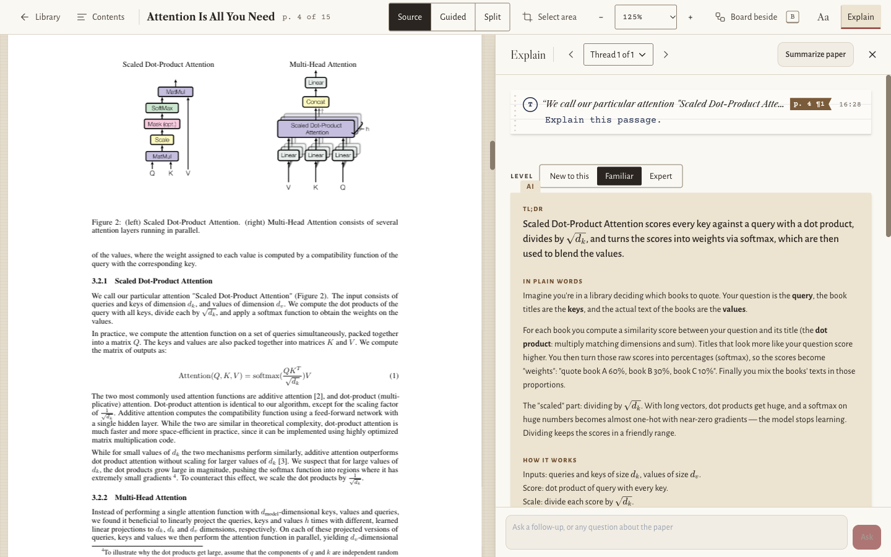<br/><sub><b>A tutor answer.</b> The ask on its call slip, the level switch, then TL;DR, In plain words, How it works.</sub></td>
    <td>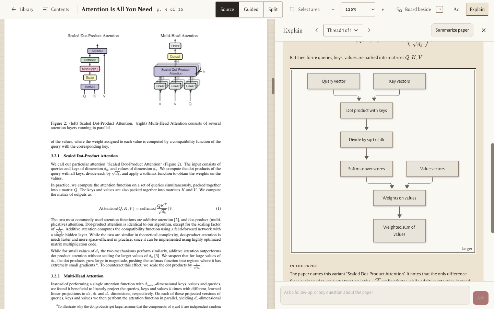<br/><sub><b>A diagram in the answer.</b> The flowchart of scaled dot-product attention, beside the paper's own Figure 2.</sub></td>
  </tr>
  <tr>
    <td>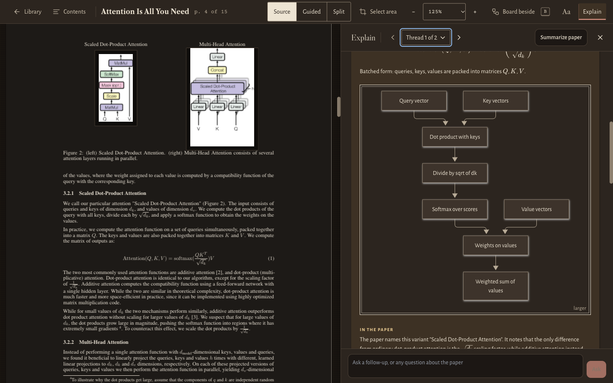<br/><sub><b>The same, on a dark page.</b> The figures stay on light mats; the diagram takes the dark tokens.</sub></td>
    <td>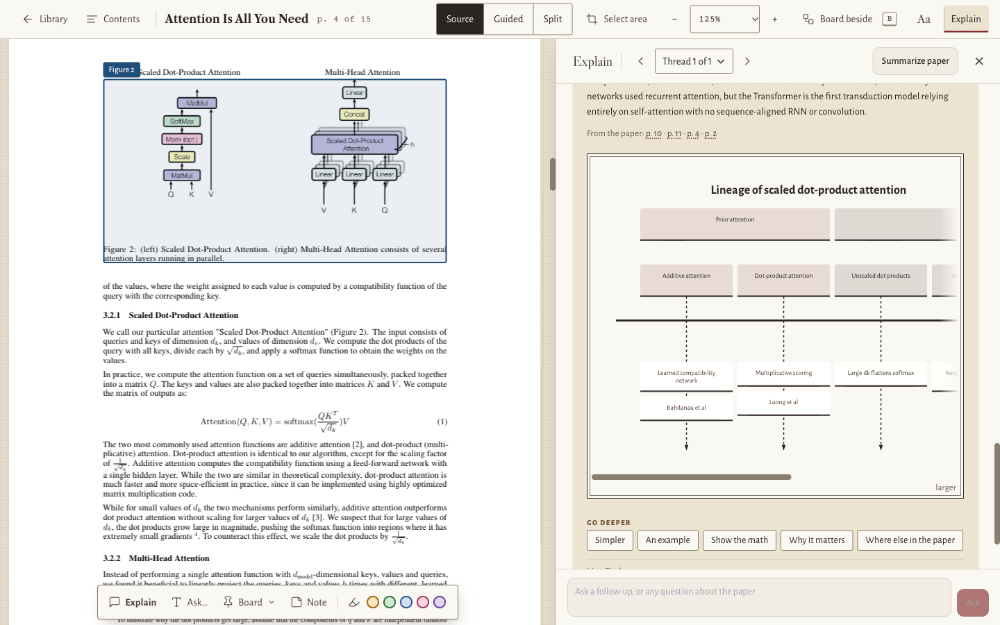<br/><sub><b>One click selects a figure.</b> Explain, Ask…, Board, Note, or a highlight colour.</sub></td>
  </tr>
  <tr>
    <td>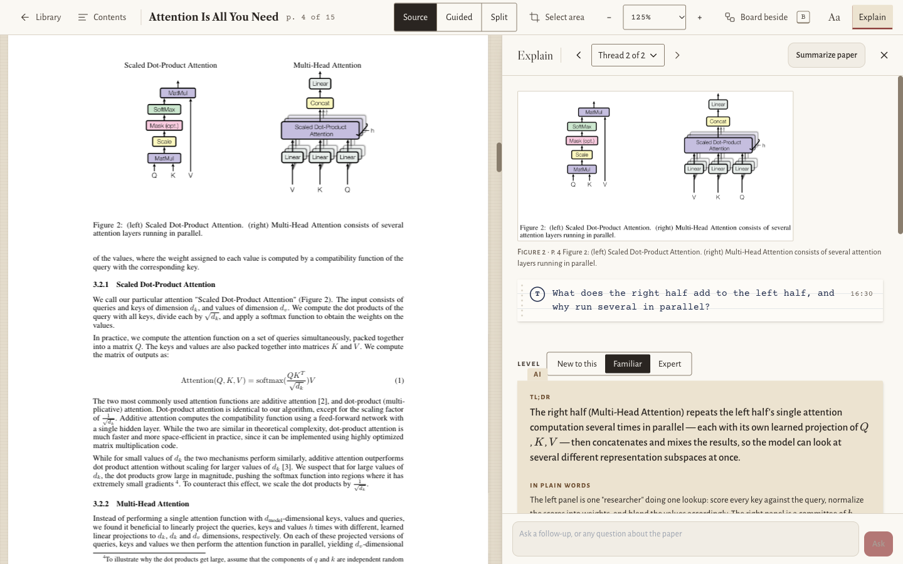<br/><sub><b>Asking about a figure.</b> The crop heads the thread; the question is the reader's own; the answer follows.</sub></td>
    <td>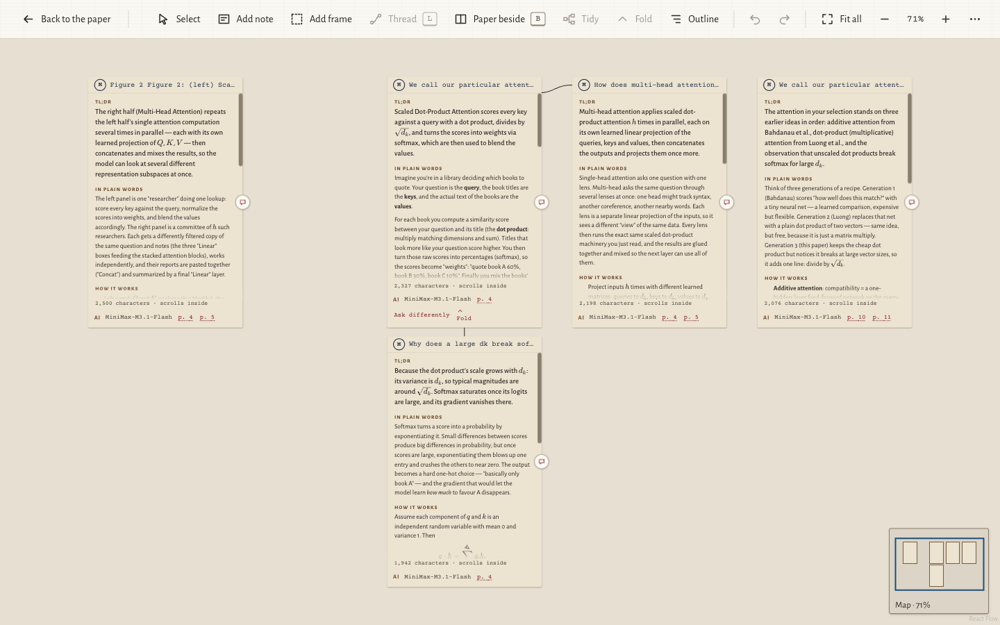<br/><sub><b>The board.</b> Down is a follow-up, right is a branch; the last tree has been moved clear of the branch.</sub></td>
  </tr>
  <tr>
    <td colspan="2">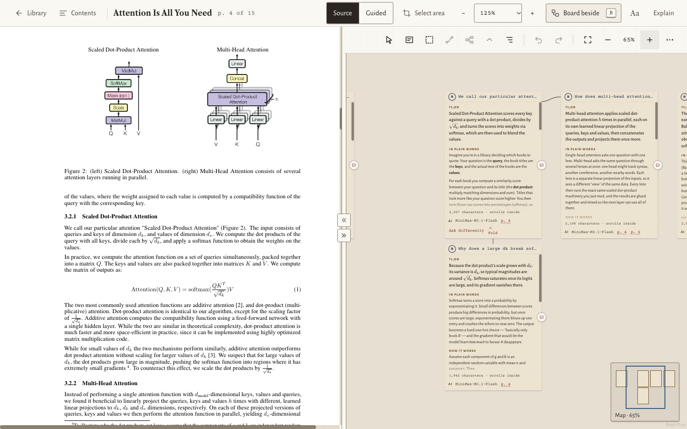<br/><sub><b>Board beside.</b> The paper on the left, the board's tree on the right.</sub></td>
  </tr>
</table>

<p align="center">
  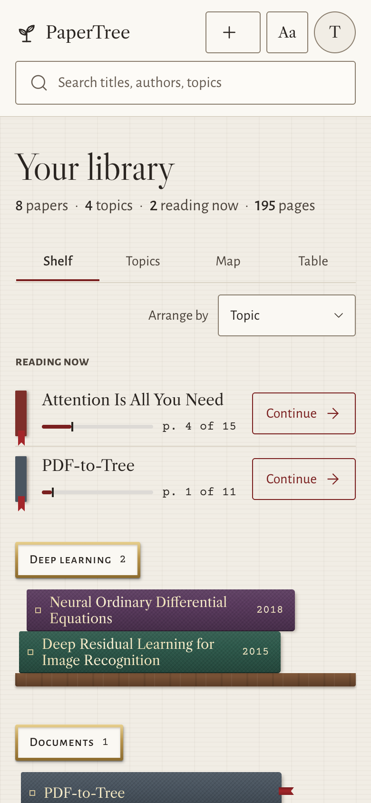
  &nbsp;
  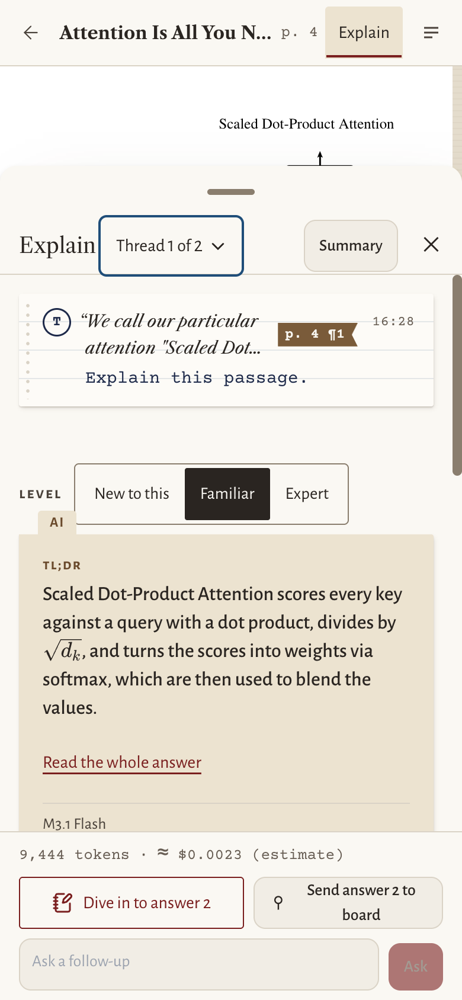
  <br/><sub><b>Phone (390 px).</b> The library, and the explain sheet with Dive in and Send answer to board.</sub>
</p>

The v0.2 screenshots (Topics, the Map, the Table, the plate, the notebook, the lamp-lit reader) are still in
[`docs/assets/readme/v0.2/`](docs/assets/readme/v0.2/), and the v0.2 slice shots, compared against the
design's frames, are in [`research/build/v0.2-ui/shots/`](research/build/v0.2-ui/shots/).

## How it works

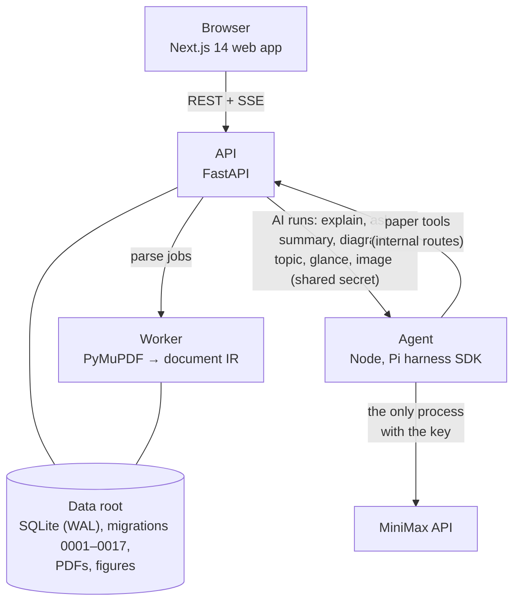

- **Web** (`apps/web`): Next.js 14. The browser talks to the API and to nothing else. The interface
  lives in one folder per feature, `apps/web/src/features/<feature>/` (library, book, reader, explain,
  diagram, notebook, board, split, highlights, settings, design-system), each with a README; the shared components
  and the design tokens are in `packages/ui`. The reader renders pages with pdf.js; the board uses React
  Flow (`@xyflow/react`); notebook ink is `perfect-freehand` outlines on an SVG layer; maths is KaTeX and diagrams are Mermaid, loaded only when an answer needs them; motion is CSS and the
  Web Animations API, with no animation library
  ([ADR-004](research/architecture-decisions/ADR-004-v0.2-ui-stack.md)).
- **API** (`services/api`): FastAPI, the only public edge. Accounts, uploads, the paper store, highlights,
  reading state, topics, threads, summaries, notebooks, boards and the `ai_runs` ledger. Data lives in one
  SQLite file plus a few folders under the data root. The schema moves forward by numbered migrations
  (`infrastructure/migrations/`, 0001–0017; v0.3 adds 0012–0017), which the API and the worker apply when
  they start.
- **Worker** (`python -m papertree_api.worker`): parses uploaded PDFs with PyMuPDF into the paper's
  structure (sections, blocks, figures, tables, equations) while you wait. It shares the API's data root.
- **Agent** (`services/agent`): a small Node service that runs the AI through the Pi harness SDK against
  MiniMax. It binds `127.0.0.1`, is called only by the API, is the only process that ever holds the
  MiniMax key, and loads nothing from `~/.pi` or any `AGENTS.md`
  ([`services/agent/README.md`](services/agent/README.md)).

### Anchors, citations and the flash

- **Anchors.** A highlight, a citation, a notebook quote card, a board passage card, a diagram part and a
  book's plate each point at the paper through an Anchor (`@papertree/anchoring`, schema
  `contracts/anchor/anchor-v1.schema.json`). An Anchor holds the quoted text and the boxes it covers on the
  page, tied to the paper and its PDF's SHA-256. Highlights are painted from the stored boxes. For each
  parse the anchor is resolved to the paper's blocks, and the result is cached; a highlight that cannot be
  placed goes to the tray rather than to a guess. Anchors minted on the server cover whole blocks for now
  ([#123](https://github.com/Legend101Zz/PaperTree/issues/123)).
- **Citations.** The paper's text reaches the model marked as untrusted data, in passages labelled with
  handles such as `[b3]`, and the model cites by handle. Only handles issued in that run count: an
  invented one is dropped and logged. Each citation gets an Anchor. The web never draws the handles: it
  gathers them into one source line of pages at the end of the answer. v0.3 does not check a claim against
  the passages it cites (the lexical check and its stored verdicts were removed, migration 0015), so a
  source line says where the model looked, not that a claim is right. A citation's locator (page, ¶,
  section) is derived from the parse when it is read, never stored.
- **The flash.** A page in a source line, a plate part, a quote card or a board card's "p. n" brings the
  reader to the passage's anchor. It scrolls (240 ms, and only if the passage is off screen), then flashes
  (in 180 ms, hold 900 ms, out 600 ms), then leaves a faint outline until your next key or press. On a board
  beside the paper, the paper flashes and the board stays where it is.

### The flows

| Flow            | What happens                                                                                                                                                                                                                                                                                                                                                                                    | Stored in                                                               |
| --------------- | ----------------------------------------------------------------------------------------------------------------------------------------------------------------------------------------------------------------------------------------------------------------------------------------------------------------------------------------------------------------------------------------------- | ----------------------------------------------------------------------- |
| Library         | `GET /papers` carries each paper's reading state, the year and category from its arXiv id and stamp, counts, its topic and its plate. The reader writes your place with `PUT /papers/{id}/reading-state`.                                                                                                                                                                                       | `reading_state` (0006)                                                  |
| Topics          | `GET /papers/{id}/topic` offers a topic: first your topic that already holds papers of the same arXiv category; when that finds nothing, one short `topic` run in the background (once per paper). An offer never shelves a paper; only `PUT /papers/{id}/topic` does.                                                                                                                          | `topics`, `paper_topics` (0009)                                         |
| Map             | `GET /library/links` matches each paper's references to your other papers by arXiv id or by normalised title, and says which.                                                                                                                                                                                                                                                                   | nothing: computed on read                                               |
| The book        | `GET /papers/{id}/figures` and `/abstract`; `PUT`/`DELETE /papers/{id}/plate` chooses a figure as the cover; `PATCH /papers/{id}` renames a paper; `PATCH /auth/me` sets the bookplate's name.                                                                                                                                                                                                  | `paper_plate` (0010), `paper_title` (0012), `users.display_name` (0006) |
| Explain and ask | `POST /papers/{id}/threads` and `…/messages` stream the answer (SSE). Each citation's locator (page, ¶, section) and each answer's coverage are derived from the parse when read.                                                                                                                                                                                                               | `ai_threads`, `ai_messages`, `ai_citations`, `ai_runs`                  |
| Diagram         | A stored v0.2 diagram thread is read from `GET /papers/{id}/threads/{tid}` and can be redrawn with `POST …/messages` and `redraw_of`. Nothing in v0.3 starts one from a selection: an answer's diagram is a `mermaid` fence in its text, parse-checked and repaired by the agent before the answer is stored.                                                                                   | `ai_diagram_parts`, `ai_messages.diagram_json` (0011)                   |
| Notebook        | Dive in is `POST /papers/{id}/notebook/pages` with the answer's message id: the server seeds the page with the ask, the answer and one quote card per cited passage (each an anchor). Items and ink strokes are saved under `/notebook/pages/{id}`; `GET /papers/{id}/notebook/search` searches typed text, quotes and the answer.                                                              | `notebook_pages`, `notebook_items`, `notebook_strokes` (0007)           |
| Board           | `GET /papers/{id}/board`; cards and threads are created, moved and deleted one request per gesture. A card hangs from a parent as a follow-up (down) or a branch (right), optionally from a span of the parent's answer, and `POST /boards/{b}/nodes/{n}/asks` asks on a card. A thread names its pins (`from_port`, `to_port`), and the API refuses a pin pair its table does not allow (422). | `canvas_nodes`, `canvas_edges` (rebuilt in 0008; tree columns in 0016)  |
| Glance          | `GET /papers/{id}/glance`: the spread's "Paper at a glance" sheet, made by a background `glance` run when a paper is added and cached.                                                                                                                                                                                                                                                          | `paper_glance` (0013)                                                   |
| Images          | `GET /papers/{id}/crop` renders a tight, high-DPI crop of a page region; `POST /papers/{id}/threads` with `kind: "image"` and the picture's anchor starts an `image` run that is shown the crop.                                                                                                                                                                                                | `ai_runs` (rebuilt in 0017), the thread's anchor                        |

### AI run kinds

Every AI request is one run of one kind. The API starts it, the agent runs it, and its row in `ai_runs`
records the model, tokens, estimated cost and code path. The limits are the API's
(`services/api/python/papertree_api/agent_client.py`, `LIMITS`); the model for each kind is under
[Model policy](#model-policy).

| Kind      | Started by                                                                          | Deadline | Output tokens | Tool calls | Retries |
| --------- | ----------------------------------------------------------------------------------- | -------- | ------------- | ---------- | ------- |
| `explain` | Explain or Ask on a selection, and every follow-up in that thread                   | 45 s     | 4,096         | 8          | 1       |
| `ask`     | A question about the whole paper (no selection), and its follow-ups                 | 60 s     | 4,096         | 8          | 1       |
| `summary` | Summarize paper (cached afterwards)                                                 | 90 s     | 6,144         | 12         | 1       |
| `diagram` | Redraw of a stored v0.2 diagram thread                                              | 90 s     | 2,048         | 4          | 1       |
| `topic`   | A paper the arXiv-category rule has no topic for, once per paper, in the background | 30 s     | 1,024         | none       | none    |
| `glance`  | The spread's "Paper at a glance" sheet, in the background                           | 60 s     | 3,072         | none       | 1       |
| `image`   | Explain or Ask on a selected figure or area                                         | 75 s     | 4,096         | 4          | 1       |

A follow-up runs as its thread's kind. A topic run that fails or answers badly is simply "no suggestion".

## Quick start

### Prerequisites

- Node.js 22.x (CI pins 22.23.0; see `.nvmrc`)
- pnpm, through Corepack: `corepack enable` (the version is pinned by `packageManager` in `package.json`)
- Python 3.12 and [uv](https://docs.astral.sh/uv/)
- A MiniMax API key for the AI features. Without one you can still upload, read, highlight and use the
  board; every AI request fails visibly, and the notebook has nothing to start from, since a page starts
  from an AI answer.
- A current Chrome (or another Chromium browser). v0.3.0's checks run in Playwright's Chromium. **In
  Safari (26.3.1), selecting text in Source mode does not open Explain or Ask**
  ([#327](https://github.com/Legend101Zz/PaperTree/issues/327)); use Chrome for now. Other browsers are
  untested (Safari's handling of the 3D book is not checked either).

### Run it

Run these from the repository root. You need four terminals, one per process; use the default ports
(8000, 8200, 3000) unless something else on your machine already uses them.

**1. Clone and install** (once):

```sh
git clone https://github.com/Legend101Zz/PaperTree.git
cd PaperTree
git checkout v0.3.0          # the latest release
corepack enable
uv sync --locked --all-packages
pnpm install --frozen-lockfile
```

**2. Configure** (once):

```sh
cp .env.example .env
echo "PAPERTREE_AGENT_SECRET=$(openssl rand -hex 32)" >> .env
cp apps/web/.env.example apps/web/.env.local
```

`.env` holds everything except the model key; the API, the worker and the agent each load it with the
`source` line below. The key is never put in this file.

**3. Start the four processes**, one per terminal:

```sh
# terminal 1: API (http://127.0.0.1:8000)
set -a; source .env; set +a
uv run python -m papertree_api
```

```sh
# terminal 2: worker (parses uploads; same data root as the API)
set -a; source .env; set +a
uv run python -m papertree_api.worker
```

```sh
# terminal 3: agent (http://127.0.0.1:8200). The key goes to this process only.
set -a; source .env; set +a
read -rs MINIMAX_KEY        # paste your MiniMax key, press Enter (nothing is echoed)
PAPERTREE_MINIMAX_API_KEY="$MINIMAX_KEY" pnpm --filter @papertree/agent start
```

```sh
# terminal 4: web (http://127.0.0.1:3000)
pnpm --filter papertree-web dev -H 127.0.0.1
```

(`-H 127.0.0.1` keeps the dev server off your network; without it Next.js listens on every interface.)

**4. Open the app** at **http://127.0.0.1:3000** (not `localhost`; see Troubleshooting). Register an
account and add a PDF:

- Press **Add papers** in the header, or drop PDFs anywhere on the library. A paper being read stands in a
  kraft wrap.
- Once it has been read, click it (or press Enter) to take it off the shelf and open the book, then **Read**.
- Select a sentence and use the menu beside it: **Explain** (the pages in its source line flash the
  passage), **Ask…**, a highlight colour, **Note** or **Send to board**. Click a figure to select it, and
  ask about that.
- **Dive in** under an answer opens its notebook page; **Board** in the reader's header opens the board,
  and **Board beside** (key B) puts it next to the paper.

Check that everything is up: `curl http://127.0.0.1:8000/healthz` and `curl http://127.0.0.1:8200/healthz`
(the agent's reply names the model per kind and says `key_present: true`).

Start the web app with `pnpm`, not `next dev` directly. Its `predev` step copies the pdf.js worker into
`apps/web/public/`; without it every PDF fails with "This PDF could not be opened".

Your data is in `~/.papertree` (SQLite, uploaded PDFs, extracted figures). Delete that folder to start
clean; set `PAPERTREE_DATA_ROOT` to keep it elsewhere. A data root from the earlier release works on
v0.3.0: the API applies the new migrations (0012 to 0017) when it starts. Before the three table rebuilds it
first copies the database to `papertree.sqlite.pre-0013.bak`, `.pre-0015.bak` and `.pre-0017.bak`.

## Configuration

The variables below are every one the code reads, apart from test and research switches. The contract is
`research/build/reader-release/contracts.md` section 7, which `.env.example` and `apps/web/.env.example` follow.
Everything is optional except the secret and the key.

<details>
<summary><b>All environment variables</b></summary>

| Variable                                                                                               | Read by            | Default                   | Notes                                                                                                                         |
| ------------------------------------------------------------------------------------------------------ | ------------------ | ------------------------- | ----------------------------------------------------------------------------------------------------------------------------- |
| `PAPERTREE_DATA_ROOT`                                                                                  | api, worker        | `~/.papertree`            | SQLite plus `uploads/ assets/ staging/`; the API and the worker must share it                                                 |
| `PAPERTREE_HOST`, `PAPERTREE_PORT`                                                                     | api                | `127.0.0.1`, `8000`       |                                                                                                                               |
| `PAPERTREE_SESSION_HOURS`                                                                              | api                | `24`                      | login lifetime                                                                                                                |
| `PAPERTREE_MAX_UPLOAD_MB`                                                                              | api                | `100`                     | larger uploads are refused with 413                                                                                           |
| `PAPERTREE_SIGNING_SECRET`                                                                             | api                | random per boot           | asset URL signing; a restart invalidates open asset URLs unless you set it                                                    |
| `PAPERTREE_AGENT_URL`                                                                                  | api                | `http://127.0.0.1:8200`   | where the API reaches the agent                                                                                               |
| `PAPERTREE_AGENT_SECRET`                                                                               | api, agent         | **required for AI**       | shared secret; the API answers 503 `not_configured` without it and the agent refuses to boot                                  |
| `PAPERTREE_DAILY_BUDGET_USD`                                                                           | api                | `1.00`                    | per-user AI spend cap over a rolling 24 h, from `ai_runs.cost_usd_est`                                                        |
| `PAPERTREE_CORS_ORIGINS`                                                                               | api                | empty                     | extra browser origins beyond `http://localhost:*` and `http://127.0.0.1:*`                                                    |
| `PAPERTREE_AGENT_PORT`                                                                                 | agent              | `8200`                    | binds `127.0.0.1` only                                                                                                        |
| `PAPERTREE_API_INTERNAL_URL`                                                                           | agent              | `http://127.0.0.1:8000`   | the API origin the agent fetches paper tools from                                                                             |
| `PAPERTREE_MINIMAX_API_KEY`                                                                            | **agent only**     | **required**              | read once, then removed from the agent's environment; never `MINIMAX_API_KEY`                                                 |
| `PAPERTREE_MODEL`                                                                                      | agent              | per kind, see below       | one model for every kind: `MiniMax-M3` or `MiniMax-M3.1-Flash`                                                                |
| `PAPERTREE_MODEL_EXPLAIN`, `_ASK`, `_SUMMARY`, `_DIAGRAM`, `_TOPIC`, `_GLANCE`, `_IMAGE`               | agent              | `PAPERTREE_MODEL`         | the model for one kind (`_DIAGRAM` and `_TOPIC` are new in v0.2, `_GLANCE` and `_IMAGE` in v0.3; `_IMAGE` must accept images) |
| `PAPERTREE_MODEL_EFFORT` (+ `_EXPLAIN`, `_ASK`, `_SUMMARY`, `_DIAGRAM`, `_TOPIC`, `_GLANCE`, `_IMAGE`) | agent              | per kind, see below       | Flash only: `low`, `medium` or `high`                                                                                         |
| `PAPERTREE_AGENT_LOG_LEVEL`                                                                            | agent              | `info`                    | `debug` adds raw provider error text; keys and tokens are never logged                                                        |
| `PAPERTREE_AGENT_FAUX`                                                                                 | agent              | unset                     | `1` = a scripted test model with canned answers (the e2e suite uses it); not for real use                                     |
| `PI_OFFLINE`, `PI_TELEMETRY`, `PI_CODING_AGENT_DIR`                                                    | agent              | set by the agent          | defence in depth; do not set them                                                                                             |
| `NEXT_PUBLIC_PAPERTREE_API_URL`                                                                        | web                | `http://localhost:8000`   | the API origin as the browser reaches it; `apps/web/.env.example` sets `http://127.0.0.1:8000`                                |
| `NEXT_PUBLIC_PAPERTREE_FIXTURES`                                                                       | web                | `off`                     | `on` only in tests and demos                                                                                                  |
| `NEXT_PUBLIC_PAPERTREE_DESIGN_SYSTEM`                                                                  | web, at build time | off in a production build | v0.2: `on` serves the `/design-system` developer page from a production build; `next dev` always serves it                    |

</details>

To use a different port for the web app, set `PORT` (for example `PORT=3001 pnpm --filter papertree-web dev`).
If you move the API, change `PAPERTREE_PORT`, `PAPERTREE_API_INTERNAL_URL` and
`NEXT_PUBLIC_PAPERTREE_API_URL` together; if you move the agent, change `PAPERTREE_AGENT_PORT` and
`PAPERTREE_AGENT_URL`.

## Model policy

The agent decides which MiniMax model answers which kind of run (`services/agent/src/models.ts`,
`DEFAULT_MODELS` and `DEFAULT_EFFORTS`; [ADR-003](research/architecture-decisions/ADR-003-model-policy.md), Revision
2026-11-19). `MiniMax-M3.1-Flash` is generally available, faster and smarter than the preview the v0.1 A/B measured
([`MODEL-AB.md`](docs/release/v0.1/MODEL-AB.md), [`QUALITY.md`](docs/release/v0.1/QUALITY.md)), and it is the default for
every kind:

| Kind                                                    | Model                               | Why this effort                                                   |
| ------------------------------------------------------- | ----------------------------------- | ----------------------------------------------------------------- |
| `explain`: a selection (and follow-ups in that thread)  | `MiniMax-M3.1-Flash`, effort low    | A short answer from one selection: speed matters                  |
| `ask`: a question about the paper (and its follow-ups)  | `MiniMax-M3.1-Flash`, effort medium | An open question over a path through the paper: more reasoning    |
| `summary`                                               | `MiniMax-M3.1-Flash`, effort medium | The whole paper: structure and citations to keep straight         |
| `diagram`: redrawing a stored v0.2 plate                | `MiniMax-M3.1-Flash`, effort low    | A short, structured plate from one selection, shaped like explain |
| `topic`                                                 | `MiniMax-M3.1-Flash`, effort low    | One short JSON answer per paper, no tools                         |
| `glance`: the spread's Paper at a glance                | `MiniMax-M3.1-Flash`, effort low    | A short JSON sheet from the seed, no tools                        |
| `image`: a selected figure or area (and its follow-ups) | `MiniMax-M3.1-Flash`, effort medium | The model reads a crop before it writes; it must accept images    |

A follow-up stays on its thread's model. `PAPERTREE_MODEL=MiniMax-M3` puts every kind on M3, and
`PAPERTREE_MODEL_ASK=MiniMax-M3` puts one kind there (M3 takes no effort). The cost recorded in `ai_runs` for Flash
uses MiniMax's published rates ($0.15 input, $0.60 output, $0.015 cache read per million tokens, read 2026-11-19), and the
agent's `/healthz` says so (`cost_basis`).

## Tests and quality gates

The commands CI runs (from the repository root; `.github/workflows/ci.yml` is authoritative). CI runs on
every pull request, whatever its base, and on every push to `main`:

| Gate               | Command                                                                                                                                                                                                                      |
| ------------------ | ---------------------------------------------------------------------------------------------------------------------------------------------------------------------------------------------------------------------------- |
| Codegen drift      | `pnpm run codegen`, then the working tree must be unchanged                                                                                                                                                                  |
| TypeScript         | `pnpm run typecheck`, `pnpm run lint` (oxlint for the packages and the agent, `next lint` for `apps/web`, a doc lint for `packages/ui`), `pnpm run test`                                                                     |
| Python             | `uv run pytest`, the peak-RSS test in its own process, `uv run ruff check packages services`, `uv run ruff format --check packages services`, `uv run mypy packages/*/python services/*/python`, `tools/check-docstrings.sh` |
| Prettier           | `pnpm exec prettier --check .` (it covers `apps/web` since v0.2)                                                                                                                                                             |
| Web build          | `pnpm --filter papertree-web build`                                                                                                                                                                                          |
| Fixture validation | `node .github/scripts/validate-fixtures.mjs packages/document-ir`                                                                                                                                                            |
| End to end         | `pnpm e2e` (Playwright; starts its own API, worker, web and a faux agent on free ports)                                                                                                                                      |

Locally, run the same gates uncached: `turbo` caches, so `pnpm test` can reprint a pass it did not run. The
exact list, with `--force`, is in [`CONTRIBUTING.md`](CONTRIBUTING.md#the-gate). `pnpm install` also
installs a pre-commit hook (lefthook) that runs Prettier and the linters on staged files.

- **End to end runs in GitHub Actions.** The E2E job runs the whole Playwright suite on every PR against a
  faux agent. It fails if any spec is skipped, if Journey B (it needs the YOLO PDF) did not pass, or if
  anything failed. You can run `pnpm e2e` yourself (it needs a Chromium:
  `pnpm exec playwright install chromium`); on the maintainer's machine the full suite is left to CI.
- **The live journey** (the real model) is a separate workflow, `live-journey.yml`, gated on the
  `run-live` label; it is not part of a normal run.
- **Web unit tests never touch the network** ([#310](https://github.com/Legend101Zz/PaperTree/issues/310),
  [#312](https://github.com/Legend101Zz/PaperTree/pull/312)). `apps/web/test/setup-no-network.ts` fails any
  test that makes an unmocked request and names the origin it tried. The agent's suite runs under an audit
  that fails it on any DNS lookup or non-loopback connection, with outbound network also denied by the OS
  where it can be (`sandbox-exec` on macOS, `unshare -rn` on Linux).
- **Corpus-gated tests.** Some tests need the benchmark PDFs, which are fetched rather than committed:
  `./research/benchmarks/fetch_corpus.sh` and `./research/benchmarks/fresh/fetch_fresh.sh`. Without them
  such a test skips and says so, naming the fetch script. CI fetches both sets, checks their checksums, and
  fails if any corpus- or fresh-gated test skipped. The web build needs them too: its `prebuild` step copies
  fixtures made from the corpus and fails without them.
- A few timing tests (`test_30k_*`, the migrations spec's 30k insert) are wall-clock bounds and can flake
  on a loaded machine: re-run them alone before diagnosing.

**The counts for v0.3.0** (from the v0.3 metrics pass on the build, not from a release CI run;
[`docs/METRICS.md`](docs/METRICS.md#v03-against-v02) has the sources):

- **TypeScript: 3,807 tests**: vitest 3,547 (web 2,125, document-ir 864, anchoring 341, ui 217) and 260 agent
  tests. `pnpm exec turbo run test --force` on `e3dd830`, 0 tasks cached, 2026-11-20, 1-minute load 31 at the
  start (other sessions were running).
- **pytest: 2,688 passed**, 24 skipped or expected failures, 0 failed (2,712 collected). `uv run pytest -q
services packages` on `c32dba8`, 2026-11-20, run once, with the machine's load rising to 68 meanwhile.
- **e2e: 103 specs** in 54 files, as listed by `playwright test --list`. The metrics pass did not run
  them: CI does. v0.2's count of 88 was specs that passed in CI.

## Release notes (v0.3.0)

**v0.3.0** is the "tutor" release: a book comes off the shelf and opens in one move, an answer reads like a
tutor explaining it, a figure can be selected and asked about, and the board becomes a branching tree you
can lay beside the paper. It was built on the `release/v0.3` branch to the approved clickable prototype
(the journey in [#347](https://github.com/Legend101Zz/PaperTree/issues/347)) and tracked in
[#329](https://github.com/Legend101Zz/PaperTree/issues/329). Its pull requests are #350 and #352 to #373
([`CHANGELOG.md`](CHANGELOG.md#030---unreleased) lists them, and the issues they closed). For what v0.2 looked like, see
[the v0.2 product video](docs/assets/readme/v0.2/papertree-v0.2.mp4).

### What's new

Each area is described in full under [Features](#features).

- **The shelf and the spread:** spines on planks, widths that follow the page count; a click takes the book
  off the shelf and opens it; the spread has the abstract, an AI "Paper at a glance", Continue, Rename,
  Topic, and Delete with Undo.
- **Tutor answers:** TL;DR, In plain words, How it works and In the paper; maths typeset in KaTeX; a level
  switch; Check yourself; Go deeper; sources reduced to one quiet line of page buttons.
- **Mermaid diagrams:** flowchart, sequence, state, mindmap, timeline, quadrant, xy chart and class
  diagrams in "How it works", parse-checked and repaired by the agent before the answer is stored, drawn
  lazily from the app's tokens, keyboard-scrollable when wide, with a larger view in a dialog on board
  cards.
- **Images:** one click selects a figure, or drag an area; then Explain, Ask, Send to board or Note.
- **The branching board:** down is a follow-up, right is a branch, branch from words in an answer, path
  breadcrumb, Fold, Tidy, Outline with Markdown export, and **Board beside** for the paper and the board
  side by side.
- **Page colour:** the paper itself can be Light, Sepia or Dark, with figures on a mat.
- **Flash for every run kind** (explain, ask, summary, diagram, topic, glance, image), priced at MiniMax's
  published Flash rates. Prompts are about 55 % shorter.
- **Removed:** citation chips and the "verified" and "grounded" readouts, with the API's grounding
  verdicts (migration 0015); the catalogue card; "Explain with a diagram" as a selection action.
- **Under the hood:** migrations 0012 to 0017 (the database is copied to `.pre-0013.bak`, `.pre-0015.bak`
  and `.pre-0017.bak` before the three table rebuilds); the agent's `glance` and `image` run kinds with
  `PAPERTREE_MODEL_GLANCE` and `PAPERTREE_MODEL_IMAGE`; the `mermaid` 12.2.0 and `katex` dependencies; a
  one-arm agent bench.

### How v0.3.0 compares with v0.2.0

| Metric                 | v0.2.0                                  | v0.3.0                                                                                                                     | Source                                         |
| ---------------------- | --------------------------------------- | -------------------------------------------------------------------------------------------------------------------------- | ---------------------------------------------- |
| TypeScript tests       | 3,152                                   | **3,807** (web 2,125, agent 260, ui 217, anchoring 341, document-ir 864)                                                   | `docs/METRICS.md`; `turbo run test --force`    |
| pytest                 | 2,562 passed                            | **2,688 passed**, 24 skipped or expected failures, 0 failed                                                                | `docs/METRICS.md`; a local full run            |
| e2e (Playwright) specs | 88 of 88 passed in CI                   | **103** listed; not run for the metrics pass                                                                               | `docs/METRICS.md`                              |
| Explain input tokens   | 4,004 (one run)                         | **median 2,447** over 18 runs (−39 %)                                                                                      | v0.3 live bench, quiet re-run                  |
| Explain cost           | ≈ $0.00084 at Flash rates (one run)     | **median $0.00073**, mean $0.00086 (−13 % on the median, +2 % on the mean)                                                 | the same; v0.2's run re-priced at Flash rates  |
| Explain first text     | 2.20 s (one run)                        | **p50 2.97 s**, p90 6.58 s                                                                                                 | the same: no change one run can show           |
| Explain total time     | 3.8 s for 394 output tokens (one run)   | **p50 6.8 s**, p90 22.3 s, for a median 618 output tokens                                                                  | the same: the price of a longer answer (below) |
| Live AI by kind        | explain once, diagram twice, topic once | **every shipped kind measured** (explain, ask, follow-up, summary, glance, image, board ask): 39 of 39 quiet runs complete | the same                                       |
| Mermaid stress test    | none                                    | **237 diagrams in rounds 2 to 4, 0 render errors**, in light and dark (round 1, before the checks: 4 of 91)                | four rounds of live answers on the real stack  |

**The trade: a richer, longer answer.** The tutor answer has sections, maths, a diagram and levels, so it is
longer: a median 618 output tokens against 394 (+57 %). At the measured rate of about 104 tokens per second
after the first text, that length accounts for about 2.2 s of the 2.9 s by which the median explain is now longer.
The first text did not move, and the answer streams, so you are reading it from about 3 s. Longer answers
are the intended result of v0.3, not a regression.

**Also worse, or not known.** A summary is heavier than v0.1's one measured run (5.2 tool calls per run, a
median cost of $0.00194), and its latency was measured only on a busy machine. One explain in 18 ended in a
model timeout in the loaded run (none in the quiet 18); the reader says "The model stopped responding" and
offers a retry. The v0.2 figures above are single runs, so a "change" is one run against a median. The
numbers come from the build's heads, not from a release CI run. **Not measured:** the quality of answers (no
judge scored any), axe, reduced motion, the board at 500 cards, the library at 400 papers, bundle size, CI
wall clock, other browsers and real devices. Sources, machine loads and the rest are in
[`docs/METRICS.md`](docs/METRICS.md#v03-against-v02).

The Mermaid stress test is four rounds of live MiniMax-M3.1-Flash answers (96, 96, 96 and 64) over the eight
corpus papers. Round 1, with the prompt alone, drew 91 diagrams of which 4 failed to render (4.4 %) and 28
were too wide. The agent's parse-check and repair, the soft size caps and the token palette came after it;
rounds 2, 3 and 4 left the reader 85, 91 and 61 diagrams, none failing in light or dark. Its raw record is
kept outside the repository, in the build's evidence store.

Earlier releases: [v0.2.0](https://github.com/Legend101Zz/PaperTree/releases/tag/v0.2.0) ·
[v0.1.0](https://github.com/Legend101Zz/PaperTree/releases/tag/v0.1.0) · full history in
[CHANGELOG.md](CHANGELOG.md) and [docs/METRICS.md](docs/METRICS.md).

## Known limits (v0.3.0)

- **Nothing checks an answer.** v0.3 removed the grounding check, so no claim is marked verified or not.
  A source line says which pages the AI drew on, and the model can still be wrong. A Mermaid diagram is
  parse-checked, which says it can be drawn and nothing about whether it is right. The metrics pass did not
  score answer quality.
- **Safari:** selecting paper text in Source mode does not open Explain or Ask in Safari 26.3.1; it works
  in Chrome ([#327](https://github.com/Legend101Zz/PaperTree/issues/327)). CI's e2e runs Chromium only, and
  Firefox is untested.
- **Diagrams:** a fence the agent cannot repair is dropped, so that answer has no diagram. A wide diagram
  (mostly timelines and sequence diagrams) scrolls sideways at 70 % scale. Image answers cannot point at a
  part of the picture ([#359](https://github.com/Legend101Zz/PaperTree/issues/359)).
- **Phone and tablet:** the branching board and Board beside were not designed for a phone or a tablet.
  Under 768 px Board beside opens the full-width board instead. The prototype also left open a
  reading-size card, "Ask differently", branches from passages and notes, how deep a path is sent, and what
  "the paper" means in a card's Uses line ([#347](https://github.com/Legend101Zz/PaperTree/issues/347)).
- **Latency:** the explain takes longer than v0.2's (median 6.8 s, p90 22.3 s) because the answer is
  longer. The summary reads the paper with tools and is the slowest kind (about 17 s in the median, measured on a busy machine).
- **Anchors and the parser:** an anchor minted on the server covers a whole block, so a flash marks the
  whole paragraph ([#123](https://github.com/Legend101Zz/PaperTree/issues/123)). A3C's title parses as
  "Abstract" ([#298](https://github.com/Legend101Zz/PaperTree/issues/298); rename it from the spread's ⋯
  menu). Open parser issues: [#101](https://github.com/Legend101Zz/PaperTree/issues/101),
  [#103](https://github.com/Legend101Zz/PaperTree/issues/103) and
  [#180](https://github.com/Legend101Zz/PaperTree/issues/180).
- **Map:** the "cites it" tags can overlap each other and the lines
  ([#332](https://github.com/Legend101Zz/PaperTree/issues/332)).
- **Missing actions and open defects:** the daily cap cannot be changed in the app
  ([#256](https://github.com/Legend101Zz/PaperTree/issues/256)); a notebook item's undo after a failed
  create can leave the item on the server ([#284](https://github.com/Legend101Zz/PaperTree/issues/284));
  Dive in's page id is global, not per owner ([#300](https://github.com/Legend101Zz/PaperTree/issues/300));
  the board accepts any id as a diagram card's plate
  ([#277](https://github.com/Legend101Zz/PaperTree/issues/277)).
- **CI and tests:** the e2e job can hang until its timeout with no output
  ([#361](https://github.com/Legend101Zz/PaperTree/issues/361)); some dark-scheme axe checks may run in
  daylight ([#269](https://github.com/Legend101Zz/PaperTree/issues/269)); faux `ai_runs` rows look real
  ([#181](https://github.com/Legend101Zz/PaperTree/issues/181)).
- **Not in v0.3.0:** audio and paper replay ([#5](https://github.com/Legend101Zz/PaperTree/issues/5)), OCR
  or scanned PDFs, memory write-back, a hosted version and a Docker setup.

## Next

Open work is tracked in [#329](https://github.com/Legend101Zz/PaperTree/issues/329) and under the
[`v0.3` label](https://github.com/Legend101Zz/PaperTree/issues?q=is%3Aopen+label%3Av0.3); what is open is
the list under [Known limits](#known-limits-v030), and the prototype's undesigned parts in
[#347](https://github.com/Legend101Zz/PaperTree/issues/347). New work gets an issue before it starts.
Audio and paper replay is [#5](https://github.com/Legend101Zz/PaperTree/issues/5).

## Troubleshooting

<details>
<summary><b>Common problems and fixes</b></summary>

- **The page is zoomed or looks wrong on `localhost`.** Chrome keeps a saved zoom level per host name.
  Browse `http://127.0.0.1:3000` instead.
- **"This PDF could not be opened".** The web app was started with `next dev` instead of
  `pnpm --filter papertree-web dev`, so the pdf.js worker was never copied. Restart it with pnpm.
- **Selecting text in Safari does nothing.** In Source mode, Safari 26.3.1 does not open Explain or Ask
  from a selection ([#327](https://github.com/Legend101Zz/PaperTree/issues/327)). Use Chrome.
- **Port already in use.** Something else owns 8000, 8200 or 3000 (3000 is a common one). Pick other ports
  as described under Configuration; the four processes only need to agree with each other.
- **A spine stays in its kraft wrap** (the paper is never read). The worker is not running, or it was
  started with a different `PAPERTREE_DATA_ROOT` than the API. Both load `.env`; do not override one of
  them.
- **Explain answers "AI explanations are not configured" (503).** `PAPERTREE_AGENT_SECRET` is missing in the
  API's environment. Re-run the `echo ... >> .env` line, then restart the API and the agent.
- **The agent exits at boot** with one `agent.boot.refused` line naming the problem: usually
  `PAPERTREE_AGENT_SECRET` or `PAPERTREE_MINIMAX_API_KEY` is unset. An ambient `MINIMAX_API_KEY` is not
  used: the agent deletes it at boot and reads only `PAPERTREE_MINIMAX_API_KEY`.
- **Where the key goes.** To the agent process only, inline on its start command. If you put it in `.env` it
  is also loaded into the API and the worker, which must not hold it.
- **Daily budget reached.** AI requests are refused once your estimated spend in the last 24 h passes
  `PAPERTREE_DAILY_BUDGET_USD`; the refusal says so. The cap is set in the environment, not in the app
  ([#256](https://github.com/Legend101Zz/PaperTree/issues/256)).
- **No topic is suggested.** The arXiv-category rule only offers a topic you already use for that
  category. Otherwise the suggestion is one AI run per paper, which needs the agent and the key, runs in the
  background and shows on a later look; any failure is just "No suggestion yet". You can always choose a
  topic yourself.
- **The scheme is not the one you want.** Aa in the library header switches System, Daylight and
  Lamp-lit; the choice is kept per browser.
- **`/design-system` answers 404** in a production build. Build with `NEXT_PUBLIC_PAPERTREE_DESIGN_SYSTEM=on`;
  `next dev` always serves it.
- **Reset everything.** Stop the four processes, delete the data root (`~/.papertree` by default).

</details>

## Docs

- [`research/architecture-decisions/ADR-002-reader-release.md`](research/architecture-decisions/ADR-002-reader-release.md):
  the architecture and why
- [`research/architecture-decisions/ADR-003-model-policy.md`](research/architecture-decisions/ADR-003-model-policy.md):
  the model policy
- [`research/architecture-decisions/ADR-004-v0.2-ui-stack.md`](research/architecture-decisions/ADR-004-v0.2-ui-stack.md):
  what the v0.2 interface is built with, and what was rejected
- [`research/build/reader-release/contracts.md`](research/build/reader-release/contracts.md): the normative
  wire, database and environment contracts
- [`contracts/README.md`](contracts/README.md): the generated JSON schemas
- [`services/agent/README.md`](services/agent/README.md): the agent service
- **The features**, one README each: [library](apps/web/src/features/library/README.md),
  [book](apps/web/src/features/book/README.md), [reader](apps/web/src/features/reader/README.md),
  [explain](apps/web/src/features/explain/README.md), [diagram](apps/web/src/features/diagram/README.md),
  [notebook](apps/web/src/features/notebook/README.md), [board](apps/web/src/features/board/README.md), [split](apps/web/src/features/split/README.md),
  [highlights](apps/web/src/features/highlights/README.md), [settings](apps/web/src/features/settings/README.md),
  [design system](apps/web/src/features/design-system/README.md)
- **The v0.2 build** ([`research/build/v0.2-ui/`](research/build/v0.2-ui/)):
  [`PLAN.md`](research/build/v0.2-ui/PLAN.md) (the slices and their issues),
  [`GAP-AUDIT.md`](research/build/v0.2-ui/GAP-AUDIT.md) (the design against the app it replaced),
  [`RESULT.md`](research/build/v0.2-ui/RESULT.md) (the gates, the slices, the live spend, a verdict per
  frame), [`STATE.md`](research/build/v0.2-ui/STATE.md), the research notes on the
  [canvas](research/build/v0.2-ui/RESEARCH-R1-canvas.md), [ink](research/build/v0.2-ui/RESEARCH-R2-ink.md)
  and [diagrams and motion](research/build/v0.2-ui/RESEARCH-R3-diagrams-motion.md), and the design's
  [frames](research/build/v0.2-ui/reference/)
- [`docs/METRICS.md`](docs/METRICS.md): release metrics, and what got better or worse
- [`CHANGELOG.md`](CHANGELOG.md): the changelog
- [`AGENTS.md`](AGENTS.md): working rules and hazards for contributors and coding agents
- [`CONTRIBUTING.md`](CONTRIBUTING.md): setup, dev ports, the gate, lint rules, code layout
- [`archive/README.md`](archive/README.md): the retired v1 code, kept for reference and not part of the
  build

## Contributing

Issues and pull requests are welcome. Before you open a PR:

1. Read [`AGENTS.md`](AGENTS.md) and [`CONTRIBUTING.md`](CONTRIBUTING.md): the repository's working rules,
   its known hazards, the code layout and the lint rules.
2. Work on a branch and open a PR against `main`. Describe what you changed and how you checked it.
3. Run the gates in [Tests and quality gates](#tests-and-quality-gates) that cover your change. CI runs all
   of them on every PR, the e2e suite included.
4. Never commit a key, a secret or a machine-specific absolute path.

The v0.3 tracker ([#329](https://github.com/Legend101Zz/PaperTree/issues/329)) is the best place to find
work.

## Acknowledgements

- Built on [pdf.js](https://mozilla.github.io/pdf.js/), [PyMuPDF](https://pymupdf.readthedocs.io/),
  [React Flow](https://reactflow.dev/) (`@xyflow/react`), [Mermaid](https://mermaid.js.org/) (MIT) and
  [KaTeX](https://katex.org/) (MIT), [perfect-freehand](https://github.com/steveruizok/perfect-freehand),
  [Next.js](https://nextjs.org/), [FastAPI](https://fastapi.tiangolo.com/), the Pi harness SDK
  (`@earendil-works/pi-coding-agent`) and [MiniMax](https://www.minimax.io/) models.
- The v0.2 typefaces are Libre Caslon Display and Text, Alegreya Sans and Alegreya Sans SC, and Courier
  Prime (SIL Open Font License 1.1), self-hosted from the [Fontsource](https://fontsource.org/) packages.
- Product video made with [HyperFrames](https://github.com/heygen-com/hyperframes) (Apache-2.0); narration
  voice [Kokoro-82M](https://huggingface.co/hexgrad/Kokoro-82M) (Apache-2.0), synthesized locally; caption
  timings from [whisper.cpp](https://github.com/ggml-org/whisper.cpp) (MIT); the click sound is HyperFrames'
  bundled `click-soft.mp3` (Pixabay Content License). Full credits:
  [`docs/assets/readme/v0.2/VIDEO-CREDITS.md`](docs/assets/readme/v0.2/VIDEO-CREDITS.md).
- The v0.3 screenshots and demo loop, and the v0.2 screenshots and product video, show these papers, used as examples; they belong to their authors:
  - Vaswani et al., [_Attention Is All You Need_](https://arxiv.org/abs/1706.03762) (2017).
  - Redmon et al., [_You Only Look Once: Unified, Real-Time Object Detection_](https://arxiv.org/abs/1506.02640) (2016).
  - He et al., [_Deep Residual Learning for Image Recognition_](https://arxiv.org/abs/1512.03385) (2016).
  - Ho et al., [_Denoising Diffusion Probabilistic Models_](https://arxiv.org/abs/2006.11239) (2020).
  - Devlin et al., [_BERT: Pre-training of Deep Bidirectional Transformers for Language Understanding_](https://arxiv.org/abs/1810.04805) (2019).
  - Brown et al., [_Language Models are Few-Shot Learners_](https://arxiv.org/abs/2005.14165) (2020).
  - Chen et al., [_Neural Ordinary Differential Equations_](https://arxiv.org/abs/1806.07366) (2018).
  - Wang et al., [_SuperGLUE: A Stickier Benchmark for General-Purpose Language Understanding Systems_](https://arxiv.org/abs/1905.00537) (2019).
  - Kingma and Ba, [_Adam: A Method for Stochastic Optimization_](https://arxiv.org/abs/1412.6980) (2015).
  - Dao et al., [_FlashAttention: Fast and Memory-Efficient Exact Attention with IO-Awareness_](https://arxiv.org/abs/2205.14135) (2022).
  - He et al., [_Mask R-CNN_](https://arxiv.org/abs/1703.06870) (2017).
  - Reimers and Gurevych, [_Sentence-BERT: Sentence Embeddings using Siamese BERT-Networks_](https://arxiv.org/abs/1908.10084) (2019).
  - Zhang et al., [_PDF-to-Tree: Parsing PDF Text Blocks into a Tree_](https://aclanthology.org/2024.findings-emnlp.628/) (2024).
  - Mnih et al., [_Asynchronous Methods for Deep Reinforcement Learning_](https://arxiv.org/abs/1602.01783) (2016).

## License

PaperTree is released under the [MIT License](LICENSE). Copyright © 2026 Mrigesh Thakur.

The MIT license covers this repository's own code. Its dependencies keep their own licenses. Note that
the PDF parser uses [PyMuPDF](https://pymupdf.readthedocs.io/), which is licensed under the AGPL-3.0
(or a commercial license from Artifex). If you distribute PaperTree or run it as a network service for
others, check PyMuPDF's terms. The benchmark papers are fetched from their sources, not redistributed, and
keep their own licenses.

## Author

**Mrigesh Thakur** · GitHub [@Legend101Zz](https://github.com/Legend101Zz)

If PaperTree is useful to you, a ⭐ on the repository helps others find it.
