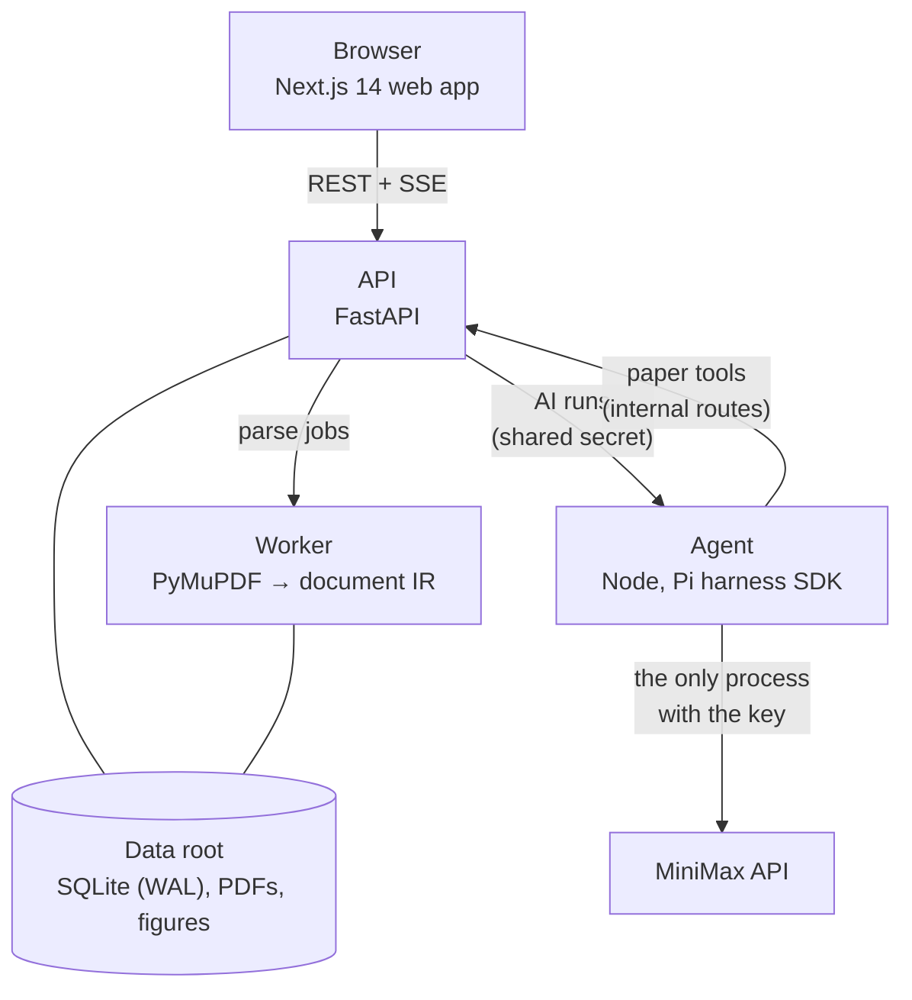

<div align="center">

# PaperTree

**Read research papers with an AI that shows its sources.**

Upload a PDF, read the real pages, highlight passages, ask questions that are answered from the paper
with citations that jump back to the exact passage, and lay out what you found on a canvas.

[](https://github.com/Legend101Zz/PaperTree/releases/tag/v0.1.0)
[](https://github.com/Legend101Zz/PaperTree/actions/workflows/ci.yml)
[](LICENSE)
[](https://github.com/Legend101Zz/PaperTree/commits/main)
[](https://github.com/Legend101Zz/PaperTree/stargazers)

[](https://nextjs.org)
[](https://www.typescriptlang.org)
[](https://nodejs.org)
[](https://www.python.org)
[](https://fastapi.tiangolo.com)
[](https://www.sqlite.org)
[](https://pnpm.io)
[](https://docs.astral.sh/uv/)
[](#model-policy)

[](#tests-and-quality-gates)
[](#tests-and-quality-gates)
[](#tests-and-quality-gates)
[](#features)

[Quick start](#quick-start) · [Features](#features) · [Screenshots](#screenshots) ·
[Release notes](#release-notes-v010) · [Roadmap](#roadmap) · [Docs](#docs)

<br/>


<sub>A real session on v0.1.0 with the live model: upload, explain a passage, a follow-up, a citation, the
summary, a highlight and the canvas. It plays at about 1.35× speed; the waits for the model and a few pauses
are sped up further.</sub>

</div>

---

## Contents

- [Why PaperTree](#why-papertree)
- [Features](#features)
- [Screenshots](#screenshots)
- [How it works](#how-it-works)
- [Quick start](#quick-start)
- [Configuration](#configuration)
- [Model policy](#model-policy)
- [Tests and quality gates](#tests-and-quality-gates)
- [Release notes (v0.1.0)](#release-notes-v010)
- [Roadmap](#roadmap)
- [Troubleshooting](#troubleshooting)
- [Docs](#docs)
- [Contributing](#contributing)
- [License](#license)
- [Author](#author)

## Why PaperTree

Most "chat with your PDF" tools turn the paper into text, lose the page, and give you answers you cannot
check. PaperTree keeps the paper as the paper:

- **You read the real pages.** Source mode is the PDF itself with selectable text. Guided mode reflows the
  paper's own words into one column, and Split shows both.
- **Every AI claim points back to the page.** Answers carry citation chips. Click one and the reader
  scrolls to the cited passage and flashes it. AI text is styled apart from the paper's own words.
- **Highlights stay where you put them.** They are stored as anchors and painted from stored
  coordinates, so they come back in the same place after a reload. A highlight that can't be placed goes to
  a tray with the reason; it is never painted in the wrong spot.
- **Failures are shown, not hidden.** A PDF that can't be read says why. An AI run that fails or is
  stopped says so, and the part that did arrive is kept.
- **You can see what every AI call cost.** Each run records its model, tokens, estimated cost, latency
  and the exact code path. A daily spend cap is on by default.
- **It runs on your machine.** It uses one SQLite file and a data folder. The model key stays in one
  process.

## Features

What v0.1.0 does. Each item was checked in a real browser (Chrome, driven through Playwright) against
the real stack and model on the release code. A few items, such as drag and drop, Cancel and the
budget message, were carried over from an earlier walk of nearly the same code; the full feature table
marks them "carried"
([`research/build/READER-RELEASE-RESULT.md`](research/build/READER-RELEASE-RESULT.md)).

| Area                  | What you can do                                                                                                                                                                                                                                                                                   |
| --------------------- | ------------------------------------------------------------------------------------------------------------------------------------------------------------------------------------------------------------------------------------------------------------------------------------------------- |
| **Library**           | Register and sign in. Upload PDFs with the file picker or by drag and drop, with progress and Cancel. Cards go Queued → Reading → Ready without a reload and show the real title and page count.                                                                                                  |
| **Reader**            | Source (the PDF), Guided (the paper's words in one column) and Split. Zoom, mode switches and reloads keep your place. Contents has Outline, Pages and Highlights tabs. A paper still being read opens at once.                                                                                   |
| **Highlights**        | Highlight a sentence, a table cell, a figure label or a passage across paragraphs. Change the colour, add a note, delete. A highlight that can't be placed goes to a tray with the reason.                                                                                                        |
| **Explain and ask**   | Select a passage and press Ask: the answer streams, with status labels. Ask follow-ups or free questions about the paper. Stop keeps the partial answer; Retry after an error.                                                                                                                    |
| **Citations**         | Answers carry page chips. A chip scrolls to the cited passage and flashes it.                                                                                                                                                                                                                     |
| **Summary**           | A paper summary with cited bullets. It is cached, so a reload does not pay for it again.                                                                                                                                                                                                          |
| **Canvas**            | Send passages and answers to a per-paper canvas. Drag, connect cards with labelled links (supports, contradicts, derives from, answers, compares with, references, or a plain link), add notes, group, delete with Undo. "Open source" jumps back to the passage.                                 |
| **Cost and evidence** | A usage line under each answer (tokens and estimated cost). Each run is recorded in `ai_runs` with model, provider, tokens, cost, first-text time, latency, request id and code path. A daily budget cap.                                                                                         |
| **Everywhere**        | Desktop (1440 px) and phone (390 px), light and dark, keyboard navigation. axe reported 0 serious or critical issues in all 12 combinations tested (the library, reader Source and reader Guided, each at 1440 and 390 px, light and dark); the canvas and the explain panel were not axe-tested. |

## Screenshots

All screenshots are of the real app (v0.1.0) on four arXiv papers. They are credited under
[Acknowledgements](#acknowledgements).

<table>
  <tr>
    <td width="50%"><br/><sub><b>Explain.</b> Select a passage and press Ask. The answer cites pages.</sub></td>
    <td width="50%"><br/><sub><b>Citations you can check.</b> A chip takes you to the passage it cites.</sub></td>
  </tr>
  <tr>
    <td><br/><sub><b>Summary.</b> Cited bullets, cached after the first run. A citation the checker can't verify says "not verified".</sub></td>
    <td><br/><sub><b>Highlights.</b> Stored as anchors and listed in Contents.</sub></td>
  </tr>
  <tr>
    <td><br/><sub><b>Split mode.</b> The PDF beside the paper's own words reflowed.</sub></td>
    <td><br/><sub><b>Canvas.</b> Passages, answers, notes and labelled links.</sub></td>
  </tr>
  <tr>
    <td><br/><sub><b>Library.</b> Upload and watch each paper go Queued → Reading → Ready.</sub></td>
    <td><br/><sub><b>Dark mode.</b> Every screen has a light and a dark theme.</sub></td>
  </tr>
</table>

<p align="center">
  
  &nbsp;
  
  &nbsp;
  
  <br/><sub><b>Phone (390 px).</b> The reader, the explain sheet and the library in dark mode.</sub>
</p>

The full set from the v0.1 hands-on test (every screen at 1440 and 390 px, light and dark) is in
[`docs/release/v0.1/screens/`](docs/release/v0.1/screens/).

## How it works



- **Web** (`apps/web`): Next.js 14. The browser talks to the API and to nothing else. The reader renders
  pages with pdf.js; the canvas uses React Flow.
- **API** (`services/api`): FastAPI, the only public edge. Accounts, uploads, the paper store, highlights,
  threads, summaries, boards and the `ai_runs` ledger. Data lives in one SQLite file plus a few folders
  under the data root.
- **Worker** (`python -m papertree_api.worker`): parses uploaded PDFs with PyMuPDF into the paper's
  structure (sections, blocks, figures, tables, equations) while you wait. It shares the API's data root.
- **Agent** (`services/agent`): a small Node service that runs the AI through the Pi harness SDK against
  MiniMax. It binds `127.0.0.1`, is called only by the API, is the only process that ever holds the
  MiniMax key, and loads nothing from `~/.pi` or any `AGENTS.md`.

## Quick start

### Prerequisites

- Node.js 22.x (CI pins 22.23.0; see `.nvmrc`)
- pnpm, through Corepack: `corepack enable` (the version is pinned by `packageManager` in `package.json`)
- Python 3.12 and [uv](https://docs.astral.sh/uv/)
- A MiniMax API key for the AI features. Without one you can still upload, read, highlight and use the
  canvas; every AI request fails visibly.
- A current Chrome. The release was tested in Chrome 155; other Chromium browsers and Firefox are untested.

### Run it

Run these from the repository root. You need four terminals, one per process; use the default ports
(8000, 8200, 3000) unless something else on your machine already uses them.

**1. Clone and install** (once):

```sh
git clone https://github.com/Legend101Zz/PaperTree.git
cd PaperTree
git checkout v0.1.0   # the release this README describes
corepack enable
uv sync --locked --all-packages
pnpm install --frozen-lockfile
```

**2. Configure** (once):

```sh
cp .env.example .env
echo "PAPERTREE_AGENT_SECRET=$(openssl rand -hex 32)" >> .env
cp apps/web/.env.example apps/web/.env.local
```

`.env` holds everything except the model key; the API, the worker and the agent each load it with the
`source` line below. The key is never put in this file.

**3. Start the four processes**, one per terminal:

```sh
# terminal 1: API (http://127.0.0.1:8000)
set -a; source .env; set +a
uv run python -m papertree_api
```

```sh
# terminal 2: worker (parses uploads; same data root as the API)
set -a; source .env; set +a
uv run python -m papertree_api.worker
```

```sh
# terminal 3: agent (http://127.0.0.1:8200). The key goes to this process only.
set -a; source .env; set +a
read -rs MINIMAX_KEY        # paste your MiniMax key, press Enter (nothing is echoed)
PAPERTREE_MINIMAX_API_KEY="$MINIMAX_KEY" pnpm --filter @papertree/agent start
```

```sh
# terminal 4: web (http://127.0.0.1:3000)
pnpm --filter papertree-web dev -H 127.0.0.1
```

(`-H 127.0.0.1` keeps the dev server off your network; without it Next.js listens on every interface.)

**4. Open the app** at **http://127.0.0.1:3000** (not `localhost`; see Troubleshooting). Register an
account, then "Choose PDFs" to upload one. When its card shows "Ready", open it, select a sentence and use
the toolbar: Highlight, Ask (opens the Explain panel; its citation chips jump back to the passage) or
Send to canvas (puts the passage on that paper's canvas, reachable from the "Canvas" link in the reader).

Check that everything is up: `curl http://127.0.0.1:8000/healthz` and `curl http://127.0.0.1:8200/healthz`
(the agent's reply names the model per kind and says `key_present: true`).

Start the web app with `pnpm`, not `next dev` directly. Its `predev` step copies the pdf.js worker into
`apps/web/public/`; without it every PDF fails with "This PDF could not be opened".

Your data is in `~/.papertree` (SQLite, uploaded PDFs, extracted figures). Delete that folder to start
clean; set `PAPERTREE_DATA_ROOT` to keep it elsewhere.

## Configuration

Exactly the variables below exist (`.env.example` and `apps/web/.env.example` are this table; the contract
is `research/build/reader-release/contracts.md` section 7). Everything is optional except the secret and
the key.

<details>
<summary><b>All environment variables</b></summary>

| Variable                                                    | Read by        | Default                 | Notes                                                                                          |
| ----------------------------------------------------------- | -------------- | ----------------------- | ---------------------------------------------------------------------------------------------- |
| `PAPERTREE_DATA_ROOT`                                       | api, worker    | `~/.papertree`          | SQLite plus `uploads/ assets/ staging/`; the API and the worker must share it                  |
| `PAPERTREE_HOST`, `PAPERTREE_PORT`                          | api            | `127.0.0.1`, `8000`     |                                                                                                |
| `PAPERTREE_SESSION_HOURS`                                   | api            | `24`                    | login lifetime                                                                                 |
| `PAPERTREE_MAX_UPLOAD_MB`                                   | api            | `100`                   | larger uploads are refused with 413                                                            |
| `PAPERTREE_SIGNING_SECRET`                                  | api            | random per boot         | asset URL signing; a restart invalidates open asset URLs unless you set it                     |
| `PAPERTREE_AGENT_URL`                                       | api            | `http://127.0.0.1:8200` | where the API reaches the agent                                                                |
| `PAPERTREE_AGENT_SECRET`                                    | api, agent     | **required for AI**     | shared secret; the API answers 503 `not_configured` without it and the agent refuses to boot   |
| `PAPERTREE_DAILY_BUDGET_USD`                                | api            | `1.00`                  | per-user AI spend cap over a rolling 24 h, from `ai_runs.cost_usd_est`                         |
| `PAPERTREE_CORS_ORIGINS`                                    | api            | empty                   | extra browser origins beyond `http://localhost:*` and `http://127.0.0.1:*`                     |
| `PAPERTREE_AGENT_PORT`                                      | agent          | `8200`                  | binds `127.0.0.1` only                                                                         |
| `PAPERTREE_API_INTERNAL_URL`                                | agent          | `http://127.0.0.1:8000` | the API origin the agent fetches paper tools from                                              |
| `PAPERTREE_MINIMAX_API_KEY`                                 | **agent only** | **required**            | read once, then removed from the agent's environment; never `MINIMAX_API_KEY`                  |
| `PAPERTREE_MODEL`                                           | agent          | per kind, see below     | one model for every kind: `MiniMax-M3` or `MiniMax-M3.1-Flash-Preview`                         |
| `PAPERTREE_MODEL_EXPLAIN`, `_ASK`, `_SUMMARY`               | agent          | `PAPERTREE_MODEL`       | the model for one kind                                                                         |
| `PAPERTREE_MODEL_EFFORT` (+ `_EXPLAIN`, `_ASK`, `_SUMMARY`) | agent          | `low`                   | Flash only: `low`, `medium` or `high`                                                          |
| `PAPERTREE_AGENT_LOG_LEVEL`                                 | agent          | `info`                  | `debug` adds raw provider error text; keys and tokens are never logged                         |
| `PAPERTREE_AGENT_FAUX`                                      | agent          | unset                   | `1` = a scripted test model with canned answers (the e2e suite uses it); not for real use      |
| `PI_OFFLINE`, `PI_TELEMETRY`, `PI_CODING_AGENT_DIR`         | agent          | set by the agent        | defence in depth; do not set them                                                              |
| `NEXT_PUBLIC_PAPERTREE_API_URL`                             | web            | `http://localhost:8000` | the API origin as the browser reaches it; `apps/web/.env.example` sets `http://127.0.0.1:8000` |
| `NEXT_PUBLIC_PAPERTREE_FIXTURES`                            | web            | `off`                   | `on` only in tests and demos                                                                   |

</details>

To use a different port for the web app, set `PORT` (for example `PORT=3001 pnpm --filter papertree-web dev`).
If you move the API, change `PAPERTREE_PORT`, `PAPERTREE_API_INTERNAL_URL` and
`NEXT_PUBLIC_PAPERTREE_API_URL` together; if you move the agent, change `PAPERTREE_AGENT_PORT` and
`PAPERTREE_AGENT_URL`.

## Model policy

The agent decides which MiniMax model answers which kind of request
([ADR-003](research/architecture-decisions/ADR-003-model-policy.md)). The defaults were chosen from an A/B
test and a 3-judge quality panel ([`MODEL-AB.md`](docs/release/v0.1/MODEL-AB.md),
[`QUALITY.md`](docs/release/v0.1/QUALITY.md)):

| Request                                                    | Model                                    | Why                                                                                                        |
| ---------------------------------------------------------- | ---------------------------------------- | ---------------------------------------------------------------------------------------------------------- |
| Explain a selection (and follow-ups in that thread)        | `MiniMax-M3.1-Flash-Preview`, effort low | First text p50 1.8 s in the A/B, against 9.3 s on M3                                                       |
| Ask: a question about the whole paper (and its follow-ups) | `MiniMax-M3`                             | Flash's ask follow-ups drew 9 wrong-citation marks against 0 for M3 (3 follow-ups, 3 judges, summed)       |
| Summary                                                    | `MiniMax-M3`                             | Flash summaries (effort medium) had 14 unsupported claims against 3 for M3 (3 summaries, 3 judges, summed) |

A follow-up stays on its thread's model. Follow-ups to an explanation therefore run on Flash; the quality
panel's follow-ups were all asks, so that case has not been measured. `PAPERTREE_MODEL=MiniMax-M3` puts every
kind on M3, and `PAPERTREE_MODEL_ASK=MiniMax-M3.1-Flash-Preview` puts ask back on Flash. MiniMax publishes no price for Flash, so the cost recorded in `ai_runs` for Flash
runs is an estimate on M3's rates, and the agent's `/healthz` says so (`cost_basis`).

## Tests and quality gates

The commands CI runs (from the repository root; `.github/workflows/ci.yml` is authoritative):

| Gate          | Command                                                                                                                                                   |
| ------------- | --------------------------------------------------------------------------------------------------------------------------------------------------------- |
| Codegen drift | `pnpm run codegen`, then the working tree must be unchanged                                                                                               |
| TypeScript    | `pnpm run typecheck`, `pnpm run lint`, `pnpm run test`                                                                                                    |
| Python        | `uv run pytest`, `uv run ruff check packages services`, `uv run ruff format --check packages services`, `uv run mypy packages/*/python services/*/python` |
| Prettier      | `pnpm exec prettier --check .`                                                                                                                            |
| Web build     | `pnpm --filter papertree-web build`                                                                                                                       |
| End to end    | `pnpm e2e` (Playwright; starts its own API, worker, web and a faux agent on free ports)                                                                   |

At the v0.1.0 release the uncached local gate ran 1,858 TypeScript tests, 2,236 passing Python tests (4
skipped, 1 expected failure) and 60 of 60 Playwright specs, and every CI job was green, including the
live journey against the real model.

Some gates need the benchmark PDFs, which are fetched rather than committed:
`./research/benchmarks/fetch_corpus.sh` and `./research/benchmarks/fresh/fetch_fresh.sh`. That includes the
web build: its `prebuild` step copies fixtures made from the corpus and fails without them. `pnpm e2e` also
needs a Chromium: `pnpm exec playwright install chromium`. The live journey (real MiniMax) is a separate CI
job gated on the `run-live` label; it is not part of a normal run. A few timing tests (`test_30k_*`) are
wall-clock bounds and can flake on a loaded machine: re-run them alone before diagnosing.

## Release notes (v0.1.0)

**v0.1.0, 2026-10-15** is the first usable release. The full notes are on the
[GitHub release](https://github.com/Legend101Zz/PaperTree/releases/tag/v0.1.0) and in
[`CHANGELOG.md`](CHANGELOG.md); the metrics page is [`docs/METRICS.md`](docs/METRICS.md).

### What changed since the pre-release baseline

The baseline column is the discovery walk at `6ff15ad` (2026-09-25). `docs/METRICS.md` also has the handoff gate `45fb2db` (2026-09-26) as a second baseline.

| Metric                                 | Baseline (`6ff15ad`)                                           | v0.1 (`60ae507`)                                                                |
| -------------------------------------- | -------------------------------------------------------------- | ------------------------------------------------------------------------------- |
| Journey A: upload, parse, read         | PARTIAL (DDPM dead-letters; card only after a reload, 0 pages) | PASS                                                                            |
| Journey B: highlights                  | FAIL (mouse cannot create one; gone on reload)                 | PASS; two items PARTIAL (see Known limits)                                      |
| Journey C: explain, follow-up, summary | PARTIAL (2 of 5 asks 504; no follow-up, no summary)            | PASS                                                                            |
| Journey D: canvas                      | FAIL (404)                                                     | PASS, minimal scope                                                             |
| Journey E: which code and provider ran | code read; one socket seen                                     | PASS: request id → logs → `ai_runs` row; only socket = `api.minimax.io`         |
| Papers that parse (of 14)              | 12                                                             | 14                                                                              |
| Repo-gold pooled reading order         | 0.900 (26 discordant pairs)                                    | 0.962 (9)                                                                       |
| Explain first text                     | not streamed; 10–40 s silence                                  | Flash p50 2.13 s (n=9); 2.4 s in the hands-on test                              |
| Failed AI answers                      | 2 of 5 asks returned 504                                       | 0 of 38 A/B runs failed (3 summaries ended partial)                             |
| TS tests                               | 1,389                                                          | 1,858                                                                           |
| pytest                                 | 1,733 passed                                                   | 2,236 passed, 0 failed                                                          |
| e2e (Playwright)                       | 0                                                              | 60 specs in CI                                                                  |
| CI checks                              | 5 jobs; no prettier, build, corpus, browser or live call       | + prettier, `next build`, corpus tests, Playwright A–D, live journey; all green |
| 390 px reader                          | FAIL (scrollWidth 622)                                         | PASS                                                                            |

**Got worse** (the main items; the full list, with causes, is in [`docs/METRICS.md`](docs/METRICS.md) →
"WORSE, with cause"):

- ResNet pooled reading order 0.932 → 0.906. This was accepted: the scored pool shrank, and real discordant
  pairs went 2 → 0. Some per-type F1 scores dropped with the same parser rule. GPT-3 macro-F1 fell by
  0.0013.
- Explain on M3 got slower in one sample: first text p50 8.45 → 20.62 s (n=6, cause not attributed). This
  is why explain moved to Flash.
- The grounding check lets more fabricated claims through in mixed cases: 3 of 18 judged supported,
  against 2 of 18 before.
- The Python CI job takes about 16 min, because the corpus tests now run.
- Datamarked quotes add about 12 % input tokens.

### Known limits

- **Two hands-on items are PARTIAL:**
  - Highlighting once scrolled the reader. It is not reproduced on the release code and is guarded, but
    the cause was never found.
  - A Shift+click selection that starts at the very start of a line loses its first 1–2 characters.
- **Grounding:** the citation check is lexical. Negation and comparator swaps pass it, and names found
  only in the references list, and equation numbers, cannot be verified.
- **Other defects:** a selection across columns includes the figure caption between them; highlight delete
  has no undo; the Contents outline shows raw block labels; a Guided figure crop shows its caption twice;
  the phone canvas first opens tiny. The full list is in
  [`docs/METRICS.md`](docs/METRICS.md) → "Known defects at release".
- **Not in v0.1:** audio (Epic 4), OCR or scanned PDFs, and memory write-back. There is no hosted version
  and no Docker setup.
- **Not measured yet:** a human-scored grounding rate (#62), and latency under concurrent users.

## Roadmap

v0.2 is tracked in [#182](https://github.com/Legend101Zz/PaperTree/issues/182).

**Planned for v0.2**

- [ ] [#175](https://github.com/Legend101Zz/PaperTree/issues/175) **UI revamp with Claude Design**, first.
      One component set across the library, the reader and explain, and the canvas, starting from the
      [v0.1 screens](docs/release/v0.1/screens/).
- [ ] [#176](https://github.com/Legend101Zz/PaperTree/issues/176) **Reader:** root-cause the
      highlight scroll, fix the Shift+click start, cross-column selection, open a highlight card by mouse.
- [ ] [#177](https://github.com/Legend101Zz/PaperTree/issues/177) **Highlights:** undo for delete; real
      headings in the Contents outline.
- [ ] [#178](https://github.com/Legend101Zz/PaperTree/issues/178) **Canvas:** the full node family, a
      minimap, frames, multi-step undo, 500-node performance, and phone polish.
- [ ] [#179](https://github.com/Legend101Zz/PaperTree/issues/179) **AI:** work on the grounding check's
      known limits, Flash re-tests for ask and summary, latency for the M3 kinds and under concurrent users.
- [ ] [#180](https://github.com/Legend101Zz/PaperTree/issues/180) **Parser:** a held-out evaluation set,
      pinned corpus URLs, text beside tables.
- [ ] [#181](https://github.com/Legend101Zz/PaperTree/issues/181) **CI and tests:** label test-model runs
      in `ai_runs`, shard the Python job, fix flaky timing tests.

**Carried over:** audio and paper replay ([#5](https://github.com/Legend101Zz/PaperTree/issues/5)),
float detection that misses most floats on ResNet and Neural ODEs ([#103](https://github.com/Legend101Zz/PaperTree/issues/103)),
the inline-equation span role ([#101](https://github.com/Legend101Zz/PaperTree/issues/101)), sub-block
citation anchors ([#123](https://github.com/Legend101Zz/PaperTree/issues/123)) and a peak-memory test that
fails falsely when suites run at the same time ([#129](https://github.com/Legend101Zz/PaperTree/issues/129)).

## Troubleshooting

<details>
<summary><b>Common problems and fixes</b></summary>

- **The page is zoomed or looks wrong on `localhost`.** Chrome keeps a saved zoom level per host name.
  Browse `http://127.0.0.1:3000` instead.
- **"This PDF could not be opened".** The web app was started with `next dev` instead of
  `pnpm --filter papertree-web dev`, so the pdf.js worker was never copied. Restart it with pnpm.
- **Port already in use.** Something else owns 8000, 8200 or 3000 (3000 is a common one). Pick other ports
  as described under Configuration; the four processes only need to agree with each other.
- **Uploads stay "processing".** The worker is not running, or it was started with a different
  `PAPERTREE_DATA_ROOT` than the API. Both load `.env`; do not override one of them.
- **Explain answers "AI explanations are not configured" (503).** `PAPERTREE_AGENT_SECRET` is missing in the
  API's environment. Re-run the `echo ... >> .env` line, then restart the API and the agent.
- **The agent exits at boot** with one `agent.boot.refused` line naming the problem: usually
  `PAPERTREE_AGENT_SECRET` or `PAPERTREE_MINIMAX_API_KEY` is unset. An ambient `MINIMAX_API_KEY` is not
  used: the agent deletes it at boot and reads only `PAPERTREE_MINIMAX_API_KEY`.
- **Where the key goes.** To the agent process only, inline on its start command. If you put it in `.env` it
  is also loaded into the API and the worker, which must not hold it.
- **Daily budget reached.** AI requests are refused once your estimated spend in the last 24 h passes
  `PAPERTREE_DAILY_BUDGET_USD`; the refusal says so.
- **Reset everything.** Stop the four processes, delete the data root (`~/.papertree` by default).

</details>

## Docs

- [`research/architecture-decisions/ADR-002-reader-release.md`](research/architecture-decisions/ADR-002-reader-release.md):
  the architecture and why
- [`research/architecture-decisions/ADR-003-model-policy.md`](research/architecture-decisions/ADR-003-model-policy.md)
  and [`docs/release/v0.1/MODEL-AB.md`](docs/release/v0.1/MODEL-AB.md): models
- [`research/build/reader-release/contracts.md`](research/build/reader-release/contracts.md): the normative
  wire, database and environment contracts
- [`contracts/README.md`](contracts/README.md): the generated JSON schemas
- [`services/agent/README.md`](services/agent/README.md): the agent service
- [`docs/METRICS.md`](docs/METRICS.md): release metrics, and what got better or worse
- [`research/build/READER-RELEASE-RESULT.md`](research/build/READER-RELEASE-RESULT.md): the v0.1 hands-on
  feature table
- [`AGENTS.md`](AGENTS.md): working rules and hazards for contributors and coding agents
- [`docs/release/v0.1/PLAN.md`](docs/release/v0.1/PLAN.md): the v0.1 release plan
- [`archive/README.md`](archive/README.md): the retired v1 code, kept for reference and not part of the
  build

## Contributing

Issues and pull requests are welcome. Before you open a PR:

1. Read [`AGENTS.md`](AGENTS.md): it lists the repository's working rules and its known hazards.
2. Work on a branch and open a PR against `main`; describe what you changed and how you checked it.
3. Run the gates in [Tests and quality gates](#tests-and-quality-gates) that cover your change. CI runs all
   of them on every PR.
4. Never commit a key, a secret or a machine-specific absolute path.

The v0.2 tracker ([#182](https://github.com/Legend101Zz/PaperTree/issues/182)) is the best place to find
work.

## Acknowledgements

- Built on [pdf.js](https://mozilla.github.io/pdf.js/), [PyMuPDF](https://pymupdf.readthedocs.io/),
  [React Flow](https://reactflow.dev/), [Next.js](https://nextjs.org/),
  [FastAPI](https://fastapi.tiangolo.com/), the Pi harness SDK (`@earendil-works/pi-coding-agent`) and
  [MiniMax](https://www.minimax.io/) models.
- The screenshots and the demo show these papers, used as examples; they belong to their authors:
  - Vaswani et al., [_Attention Is All You Need_](https://arxiv.org/abs/1706.03762) (2017).
  - Redmon et al., [_You Only Look Once: Unified, Real-Time Object Detection_](https://arxiv.org/abs/1506.02640) (2016).
  - He et al., [_Deep Residual Learning for Image Recognition_](https://arxiv.org/abs/1512.03385) (2016).
  - Ho et al., [_Denoising Diffusion Probabilistic Models_](https://arxiv.org/abs/2006.11239) (2020).

## License

PaperTree is released under the [MIT License](LICENSE). Copyright © 2026 Mrigesh Thakur.

The MIT license covers this repository's own code. Its dependencies keep their own licenses. Note that
the PDF parser uses [PyMuPDF](https://pymupdf.readthedocs.io/), which is licensed under the AGPL-3.0
(or a commercial license from Artifex). If you distribute PaperTree or run it as a network service for
others, check PyMuPDF's terms. The benchmark papers are fetched from their sources, not redistributed, and
keep their own licenses.

## Author

**Mrigesh Thakur** · GitHub [@Legend101Zz](https://github.com/Legend101Zz)

If PaperTree is useful to you, a ⭐ on the repository helps others find it.
